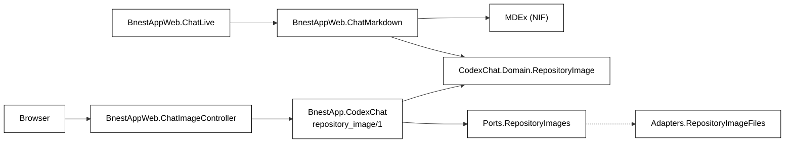

# 002. Markdown Codex Replies With Safe Repository Images

Date: 2026-11-10

Status: Proposed

## Context

Codex replies in `/chat` read as formatted Markdown, and images in a reply are shown. The specs, BDD bindings and tests
describe and check this behaviour.

Facts checked in the code and the installed tools:

- `BnestAppWeb.ChatLive` renders an assistant reply as
  `<p class="message-content whitespace-pre-wrap" data-role="assistant-message" ...>` with plain text. Visitor messages
  stay plain escaped text.
- A transcript stores each message as a raw string (`Domain.Transcript`, at most 200 messages of 100,000 bytes). The
  stored value is already the model's Markdown, so no schema change is needed.
- Codex runs through `priv/codex/chat_runner.mjs` and `@openai/codex-sdk` 0.149.1 (CLI `codex-cli 0.149.1`). The SDK has
  no image item type (`ThreadItem` is agent message, reasoning, command, file change, MCP call, web search, todo list,
  error). An image can only reach the chat as Markdown text inside an `agent_message`. The sandbox is `read-only` or
  `workspace-write`, network is off and web search is disabled, so Codex cannot fetch an image itself.
- The Codex working directory is `config :bnest_app, :codex, working_directory:`. It defaults to the repository root
  (`config/config.exs`) and `config/runtime.exs` overrides it from `BNEST_CODEX_WORKING_DIRECTORY`. The systemd and
  launchd tools set that variable to the repository root of the running checkout.
- Routes: `/chat` is a LiveView in the `[:browser, :authenticated_browser]` scope. `:browser` runs
  `fetch_current_user` and `put_secure_browser_headers`. Any signed-in role, including a child, can open `/chat`.
- There is no Content-Security-Policy anywhere: not in `router.ex`, `endpoint.ex`, `ReleaseHeaders`, the root layout or
  `tools/caddy-config.mjs`.
- `mix.exs` makes infrastructure apps boundaries: `boundary: [default: [check: [apps: [...]]]]`. Only a boundary that
  lists such an app in `deps` may call it. Contexts keep outside I/O behind `Ports` and `Adapters`.
- All unit-test coverage is gated at 99%. `.Adapters.`, LiveViews and controllers are left out of that denominator and
  are proved by `test:integration`.

## Decision 1. Markdown renderer: MDEx 0.14.6

### Requirement

Safe GitHub-flavoured Markdown for untrusted model output: paragraphs, headings, bold and italic, ordered, unordered and
task lists, inline and fenced code, tables, blockquotes, rules, links, strikethrough, images. Raw HTML must not run.
Unsafe URL schemes must be dropped. Links open in a new tab with `rel="noopener noreferrer nofollow"`. Half-written
Markdown must stay readable while a reply streams.

### Considered

| Option                                  | Result                                                                                                                                                                                                                                                                                                         |
| --------------------------------------- | -------------------------------------------------------------------------------------------------------------------------------------------------------------------------------------------------------------------------------------------------------------------------------------------------------------- |
| No library (own parser)                 | Rejected. A Markdown parser plus sanitizer is the kind of code that hides XSS bugs. Disproportionate security and maintenance cost.                                                                                                                                                                            |
| Earmark 1.4.49 + html_sanitize_ex 1.5.6 | Rejected. `escape: true` still emits `<a href="javascript:alert(1)">`; no task lists (`[x] done` stays text); `HtmlSanitizeEx.basic_html` removes `` and every attribute, so a custom scrubber is needed for images, `rel` and `target`. Two dependencies and own scrubber code, and still no task lists. |
| MDEx 0.14.6 (comrak + ammonia)          | Chosen. One dependency covers parsing, the GFM extensions, an AST, a sanitizer, a parse budget and auto-closing of unfinished syntax.                                                                                                                                                                          |

### Evidence (current primary sources, checked 2026-11-10)

- hex.pm: `mdex` 0.14.6, published 2026-10-31, MIT. Releases on 10-23, 10-28, 10-29 and 10-31 show active upkeep.
  About 2.1 million downloads in total, about 1.0 million recent. Requires `jason ~> 1.0`, `mdex_native >= 0.3.1`,
  `nimble_options ~> 1.0`, `nimble_parsec ~> 1.0`; `phoenix_live_view` is optional. All but `mdex_native` and
  `rustler_precompiled` are already in `mix.lock` (`nimble_options` 1.1.1 is locked and was proved to work).
- GitHub `leandrocp/mdex`: MIT, not archived, pushed 2026-11-06, one open issue, a `SECURITY.md`, used by Hexpm, Tuist,
  Ash AI and others.
- Two published advisories, both patched in 0.13.2 and below our pin: GHSA-4383-7xfp-gpph (`to_delta` did not check
  URL schemes) and GHSA-923r-7vf4-5vw8 (atom exhaustion through `parse_document({:json, _})`). **Rule: never call
  `to_delta` or `parse_document({:json, _})`.** A test scans `lib/` for both.
- Native code: `mdex_native` 0.3.1 ships SHA-256 checksums for precompiled NIFs (`checksum-Elixir.MDExNative.Native.exs`)
  for Linux x86_64 and aarch64 (glibc and musl) and macOS x86_64 and aarch64, which covers both the systemd and the
  launchd deployment tools. On this host (OTP 29.1.2, Elixir 1.20.4) `mix deps.get` plus compile downloaded
  `libmdex_native_nif-v0.3.1-nif-2.15-x86_64-unknown-linux-gnu.so` from the GitHub release, verified the checksum and
  loaded it. No Rust toolchain is needed. `MDEX_NATIVE_BUILD=1` forces a source build if a platform has no binary.
- Offline and lockfile behaviour: `mix deps.get` with the committed `mix.lock` needs hex.pm only. The first compile
  needs github.com once; the NIF is then cached in `~/.cache/rustler_precompiled`. The release build host therefore
  needs github.com access or a warm cache, as `lazy_html` and `argon2_elixir` already need a network or a C compiler.

### Pin

`{:mdex, "~> 0.14.6"}` in `apps/bnest-app/mix.exs`. For a 0.x package `~>` allows patch releases only (`>= 0.14.6`,
`< 0.15.0`). `mix.lock` pins the exact `mdex` 0.14.6, `mdex_native` 0.3.1 and `rustler_precompiled` 0.10.1. Add `:mdex`
to the `check: [apps: ...]` list in `mix.exs` and `MDEx` to `BnestAppWeb`'s boundary `deps`, so only the web layer can call it.

### Verified behaviour

| Need                              | Evidence                                                                                                                                                                                                                                                                                                                                                                                               |
| --------------------------------- | ------------------------------------------------------------------------------------------------------------------------------------------------------------------------------------------------------------------------------------------------------------------------------------------------------------------------------------------------------------------------------------------------------ |
| Raw HTML is not rendered          | `render: [escape: true]` turns `<script>`, `<b onclick>`, `<iframe>`, `` into visible escaped text. Default `unsafe: false` only drops the tags. Both are safe; `escape: true` keeps the model's text visible.                                                                                                                                                                            |
| `javascript:` links and images    | Comrak already blanked `javascript:`, `data:text/html` and `data:image/svg+xml` URLs in the test (it lets `data:image/png` through, which the AST step then removes). The AST step below removes the leftover empty `href=""`. Ammonia `url_schemes` adds a second wall.                                                                                                                               |
| Link `rel` and `target`           | Ammonia options `link_rel: "noopener noreferrer nofollow"` and `set_tag_attribute_values: %{"a" => %{"target" => "_blank"}}` produce `target="_blank" rel="noopener noreferrer nofollow"` on every link, including autolinks.                                                                                                                                                                          |
| Image attributes                  | `set_tag_attribute_values: %{"img" => %{"loading" => "lazy", "referrerpolicy" => "no-referrer", "decoding" => "async"}}` works. Replacing `tag_attributes` with a minimal map works and removes `style`, `class` on non-code tags and `title`.                                                                                                                                                         |
| Allow only chosen image sources   | Sanitizer options cannot match a URL prefix, so an AST step does it: `MDEx.parse_document/2`, then `MDEx.traverse_and_update/2` over `%MDEx.Image{}` and `%MDEx.Link{}`, then `MDEx.to_html/2` (about 10 lines, below).                                                                                                                                                                                |
| Task lists survive the sanitizer  | `add_tags: ["input"]`, `tag_attributes` for `input` (`type checked disabled`) and `tag_attribute_values: %{"input" => %{"type" => ["checkbox"]}}`.                                                                                                                                                                                                                                                     |
| Partial Markdown while streaming  | `auto_close: [links: :text, images: :text]` turns `see [link](https://exa` into `see link`, `. 20,000 nested quotes, 30,000 unclosed `*a ` and 30,000 `[a](` all finish in under 20 ms. Invalid UTF-8 **raises** `ArgumentError` from `MDEx.parse_document/2`, with or without options; it does not return `{:error, %MDEx.DecodeError{}}`. The renderer checks `String.valid?/1` first. |
| Cost                              | About 1 to 2 ms for a 1 KB reply and about 20 ms for 16 KB on this 2 vCPU host (sanitizer included); about 90 ms for 100 KB, the per-message cap. See "Streaming cost" for why this is acceptable.                                                                                                                                                                                                     |

AST step (shape; `BnestAppWeb.ChatMarkdown` is the shipped code):

```elixir
doc = MDEx.parse_document!(content, opts)           # opts: extension, render escape, budget, auto_close if streaming
doc = MDEx.traverse_and_update(doc, fn
  %MDEx.Image{url: url, nodes: alt} = node ->
    case classify_image(url) do
      {:repository, path} -> %{node | url: "/chat/images/" <> encode(path)}
      {:external, url}    -> %MDEx.Link{url: url, nodes: label_with_note(alt, url)}  # a link, never loaded
      :other              -> withheld_text(alt)                                     # "[image not shown: alt]"
    end
  %MDEx.Link{url: url, nodes: nodes} = node -> if safe_scheme?(url), do: node, else: plain(nodes)
  node -> node
end)
MDEx.to_html(doc, opts)                              # sanitize: ammonia options from the table above
```

On `{:error, _}` (the parse budget) and on input that is not valid UTF-8 (checked before MDEx is called, because MDEx
raises on it), the renderer returns the escaped text in a `whitespace-pre-wrap` paragraph, so a reply never disappears
and never becomes unsafe. The fallback itself is valid UTF-8: bytes that are not UTF-8 are replaced with U+FFFD
(`String.replace_invalid/1`) before escaping, and a unit test asserts the output is valid UTF-8.

### Ownership

One new runtime dependency with a native component. The team owns: bumping `mdex` when advisories appear (watch GitHub
advisories for `leandrocp/mdex`), keeping the URL gate in our own AST step (not in the sanitizer alone), and the XSS
corpus test. If MDEx is abandoned, the renderer is one module with one public function, so replacement is local.

## Decision 2. Images: repository paths through an authenticated route; no external or inline images

### Sources compared

| Source                                       | Decision                       | Why                                                                                                                                                                                                                                                                                                                                                                                          |
| -------------------------------------------- | ------------------------------ | -------------------------------------------------------------------------------------------------------------------------------------------------------------------------------------------------------------------------------------------------------------------------------------------------------------------------------------------------------------------------------------------- |
| `https://` image URL                         | Not loaded. Shown as a link.   | A loaded image is a silent request carrying data in its URL. If a prompt-injected or confused model reads a secret in the repository and writes ``, the browser sends it without a click. It also leaks that the visitor is reading the chat. Codex has no network, so any URL it writes comes from memory and is often dead. Little value, real risk. |
| `data:` image (png, jpeg, gif, webp, base64) | Not loaded. Shown as alt text. | A model cannot realistically write a useful base64 image (token cost), the size is unbounded in a stored transcript, and allowing `data:` in the sanitizer also allows it in `href`. No real use case.                                                                                                                                                                                       |
| Repository-relative path to a raster file    | Shipped.                       | This is what Codex can really reference: screenshots, diagrams, logos in the repository it reads. No third party sees the request. Every response is checked on the server.                                                                                                                                                                                                                  |
| SVG in any form                              | Never.                         | SVG can carry script and external references. `apps/bnest-app/priv/static/images/logo.svg` exists, so the rule must be explicit.                                                                                                                                                                                                                                                             |

If the owner later wants external images, the change is one clause in `classify_image/1` plus
`img-src https:` in a future CSP, and the `referrerpolicy="no-referrer"` and `loading="lazy"` attributes are already in
place. It is not part of this change.

### Route

`GET /chat/images/*path`, handled by `BnestAppWeb.ChatImageController.show/2`, in the existing
`[:browser, :authenticated_browser]` scope (anonymous requests are redirected to `/login`, as for every other protected
page; any signed-in role may use it, the same as `/chat`). The route finds the directory the same way the runner does:
`Application.fetch_env!(:bnest_app, :codex)[:working_directory]`, read inside the adapter, never from the request.

Rules (pure ones live in `BnestApp.CodexChat.Domain.RepositoryImage`, file ones in the adapter):

1. Reference syntax (pure). `ChatMarkdown` percent-decodes the Markdown destination once (`%20` becomes a space; a
   malformed escape is refused), and the domain sees that decoded path. It is a relative path with `/` separators.
   Drop one leading `./`. Reject: empty, absolute, `\`, NUL, a `%` left after decoding (double encoding), `:` (any
   scheme), a segment that is empty, `.` or `..`, any segment that starts with `.` (so `.git`,
   `.env`, `.codex`, `.serena`), and any segment in the deny set `data`, `node_modules`, `local-tmp`,
   `generated-reports`, `worktrees`, `_build`, `deps`, `test-results`, `playwright-report`, `blob-report`. Extension,
   lower-cased, must be `.png`, `.jpg`, `.jpeg`, `.gif` or `.webp`.
2. Containment (adapter). Start at the configured root (trusted). For every component below it, `File.lstat/1`: a
   directory for each parent, a regular file for the last. Any symlink, anywhere below the root, is refused. This avoids
   writing a real-path function (Elixir has none) and cannot be escaped with `..` or links. The adapter also refuses `.`, `..` and empty segments itself, because `lstat` of
   `..` names a real directory and would pass the directory check.
3. Size (adapter). `lstat` size at most 5 MiB (`RepositoryImage.max_bytes/0`); read at most `max + 1` bytes and refuse
   if more arrive (the file may grow between `lstat` and read).
4. Content (pure). The bytes must start with a PNG, JPEG, GIF87a/89a or `RIFF....WEBP` signature. The served
   `Content-Type` comes from the sniffed signature, never from the extension. HTML, text or SVG renamed to `.png` is
   refused.
5. Response. 200 with the in-memory bytes (no second file open, so no swap after the check): fixed image type,
   `cache-control: private, max-age=60`, `content-security-policy: default-src 'none'; sandbox`, and the pipeline's
   `x-content-type-options: nosniff`. No `Content-Disposition` filename, nothing from the request in any header.
   Every refusal (syntax, deny, missing, symlink, not a file, too large, wrong signature, read error) is the same
   `404` with an empty body, so the route is not an oracle for which files exist.

The renderer calls the same `RepositoryImage.reference/1` as the route, so a link it emits is always one the route
will accept, and a reply can never point the browser at a different route.

### Policy decisions

These are the rules the renderer and the facade apply on top of the table above. A test pins each one.

- **Links.** Only `http`, `https` and `mailto` destinations stay links, and they open in a new tab. The scheme check
  ignores spaces and control characters and compares without case. A relative link (`docs/a.md`), a protocol-relative
  link (`//evil.example`) and any other scheme (`javascript:`, `data:`, `vbscript:`) becomes its plain text.
- **Images.** The destination is decoded once (see strict decoding). A repository image (rule 1 passes) becomes
  `/chat/images/<segments>`, one encoded segment at a time. An `http` or `https` image is never loaded. It becomes a
  link to its address whose text is its alt text, or the address when there is no alt text, followed by
  `(image not shown)`, so the reader knows the picture is withheld. Any other image (`data:`, `javascript:`, a relative
  path that fails rule 1, an SVG, an absolute path) becomes its alt text inside `[image not shown: alt]`, or
  `[image not shown]` when it has no alt text.
- **Strict decoding.** A `%` that is not followed by two hex digits is a malformed escape, and decoded text that is not
  UTF-8 is refused. In both cases the destination is not a repository image; a link falls back to its plain text and an
  image to its withheld text (`[image not shown: alt]`).
- **Double encoding.** A `%` left after the one decoding (for example `%252e%252e`) is refused by rule 1, so the route
  never sees a second round of decoding.
- **Port bytes checked twice.** The facade asks the port for at most `max_bytes` and then refuses any reply longer than
  that, so a port that ignores the limit cannot serve more than 5 MiB.
- **Case.** The deny set of directory names is compared without case (`Data/prod/a.png` is refused like
  `data/prod/a.png`), because macOS and Windows treat the two as one folder. The extension is compared without case too.
- **Both URL forms.** The route accepts a path as several segments (`/chat/images/docs/a.png`) and as one encoded
  segment (`/chat/images/docs%2Fa.png`). The router decodes each segment once before the controller sees it, so
  the controller joins the segments and does not decode again.

### Threat notes (modeling-threats)

**Assets:** files in the repository checkout and anything beside it on disk (`.env`, `data/` runtime and backups,
`~/.codex`, SSH keys); the visitor's session; the visitor's privacy; availability of the 24/7 service.

**Trust boundaries:** model output (untrusted text, may be influenced by repository content) to the Markdown renderer;
browser request to the image route; image route to the file system; rendered HTML to the browser.

**Entry points added:** the Markdown renderer (input: any model text); `GET /chat/images/*path`; the developer
instruction passed to Codex.

| Threat                                                            | Choice that closes it                                                                                                                                                                                                                                      | Test that fails without it                                                                                                                                     |
| ----------------------------------------------------------------- | ---------------------------------------------------------------------------------------------------------------------------------------------------------------------------------------------------------------------------------------------------------- | -------------------------------------------------------------------------------------------------------------------------------------------------------------- |
| Script from raw HTML, `javascript:`, event attributes             | `escape: true`, AST scheme gate, ammonia allowlist (two independent layers)                                                                                                                                                                                | Unit XSS corpus (below) asserts no `<script`, no `on*=`, no unsafe `href`/`src`                                                                                |
| `target=_blank` tab-nabbing; referrer leak                        | ammonia `link_rel` and `target`; `referrerpolicy="no-referrer"` on images                                                                                                                                                                                  | Unit: every `<a>` has the exact `rel` and `target`                                                                                                             |
| Path traversal (`..`, `%2e%2e`, `%2F`, backslash, NUL)            | Syntax rule 1 on the joined path; `*path` segments joined then re-split; no percent decoding in the domain                                                                                                                                                 | Unit table of traversal strings; integration request with encoded variants                                                                                     |
| Symlink escape                                                    | Rule 2: refuse any symlink below the root                                                                                                                                                                                                                  | Integration: symlink to a file outside the root returns 404                                                                                                    |
| TOCTOU (swap after the check)                                     | Bytes read once and served from memory; signature check on the bytes served; writing under the root needs an admin in write mode or local access                                                                                                           | Accepted residual: an attacker able to write inside the checkout can only make the route serve another image-signature file; non-image files still fail rule 4 |
| Content sniffing, type spoofing, SVG or HTML as image             | Extension allowlist plus signature sniff; fixed `Content-Type`; `nosniff`; response CSP `sandbox`                                                                                                                                                          | Integration: SVG, HTML and text named `.png` return 404; response headers asserted                                                                             |
| Header injection or XSS through headers                           | No request value in any header; no `Content-Disposition` filename                                                                                                                                                                                          | Integration: header set is exactly the expected list                                                                                                           |
| Secret exposure (`.env`, data dirs, backups with image extension) | Dot-segment ban and deny set, compared without case; extension allowlist; root is the checkout only                                                                                                                                                        | Unit: `.env/x.png`, `data/prod/x.png`, `Data/prod/x.png`, `.git/x.png`, `node_modules/x.png` refused; integration: the same paths answer 404 on a real root    |
| Existence oracle                                                  | One identical 404 for every refusal                                                                                                                                                                                                                        | Integration: missing, denied and symlinked files give equal status, headers and body                                                                           |
| Denial of service through size                                    | 5 MiB cap with bounded read; read per request only; `loading="lazy"` limits browser fan-out                                                                                                                                                                | Integration: 5 MiB + 1 byte file returns 404                                                                                                                   |
| Denial of service through Markdown                                | `budget: [parse_time: 250]`; per-message 100 KB cap already in `Transcript`; fallback to escaped text                                                                                                                                                      | Unit: a time-limited parse returns the escaped fallback                                                                                                        |
| Unauthenticated read                                              | Existing `:authenticated_browser` pipeline                                                                                                                                                                                                                 | Integration: no cookie redirects to `/login`; no image bytes in the body                                                                                       |
| Cross-user read                                                   | Not applicable by design: the checkout is shared, not per user data. Children can already ask Codex about any file the sandbox reads, so the route adds a narrower window (four raster types) to the same data. Accepted by the product design of `/chat`. | n/a (accepted; recorded here)                                                                                                                                  |
| Tracking or exfiltration through external images                  | External and `data:` images are never loaded (Decision 2 table)                                                                                                                                                                                            | Unit corpus: `` yields no ``; yields a link whose text says it is not loaded                                                     |
| Injection through the developer instruction                       | Constant text in the repository; no user value is interpolated                                                                                                                                                                                             | Contract test on the text (Decision 3)                                                                                                                         |

### XSS corpus the unit test must include

`<script>alert(1)</script>`, ``, `<b onclick="x()">`, `<iframe src=x>`, `<svg onload=...>`,
`<a href="javascript:alert(1)">`, `[x](javascript:alert(1))`, `[x](JaVa&#x09;Script:alert(1))`, `[x](vbscript:x)`,
`[x](data:text/html;base64,AAAA)`, `)`, ``,
``, ``, ``,
``, ``, ``, ``, ``,
`)`, `[](javascript:alert(1))`, autolinks `<javascript:alert(1)>`,
reference-style links to `javascript:`, HTML comments, `<style>`, `<form>`, `<input>` in raw text, an `<input>` outside a
task list, `style=` and `class=` attributes, and a 100 KB message of `*a ` and `[a](`. For every case the test asserts
the output has no `<script`, `<iframe`, `<style`, `<form`, `on...=` attribute, `javascript:`, `data:` or `//`-prefixed
URL, that every `` starts with `/chat/images/`, and that every `<a>` has the exact `rel` and `target`.

## Decision 3. Codex instruction: `developer_instructions`

Checked against the installed CLI, not guessed. `codex-cli 0.149.1` accepts `-c developer_instructions="..."` and adds it
as a `developer` role message. Proof: `codex debug prompt-input -c 'developer_instructions="LINE1 MARKER_DEV\nLINE2
\"quoted\" markdown"' hello` (with an empty temporary `CODEX_HOME`, no model call) printed that exact text, newline and
quotes intact, as the first `input_text` of the first developer message. The binary also contains the keys
`developer_instructions` and `model_instructions_file`; `model_instructions_file` replaces the base model prompt, so it
is the wrong tool.

How to pass it: `new Codex({ config: { developer_instructions: TEXT } })`. The SDK flattens `config` into
`--config developer_instructions=<JSON.stringify(TEXT)>` (`toTomlValue`, `dist/index.js`), and a JSON string is a valid
TOML basic string, so multi-line text with quotes is safe without extra escaping. The SDK starts one `codex exec`
process per turn with the same arguments (also for `resumeThread`), so resumed threads get the instruction too.

Put the text in `priv/codex/chat_instructions.mjs` (exports `developerInstructions`), imported by `chat_runner.mjs`, so a
test can load it without running the runner's top-level code. Recommended text:

```text
Write every reply in GitHub-flavored Markdown: short paragraphs, lists, tables, and fenced code blocks that name their
language. Never write raw HTML.
To show an image, use Markdown image syntax with the path of an image file that exists in this repository, relative to
the repository root, for example . Only png,
jpg, jpeg, gif and webp files are shown. Never use SVG, data: URIs, absolute paths or external image URLs; they are not
displayed. Check that the file exists before you point to it.
```

Contract test (integration, no model call): load `developerInstructions`, run the installed CLI with
`codex debug prompt-input -c developer_instructions=<JSON.stringify(text)>` under a temporary `CODEX_HOME`, and assert the
text appears verbatim in a `developer` message. This fails if an SDK or CLI upgrade renames the key. A second integration test runs the production runner
(`priv/codex/chat_runner.mjs`) against a stub `@openai/codex-sdk` in a temporary directory, and asserts that the
constructor receives `config.developer_instructions` with the same text. Deleting the `config` wiring fails it. The contract
test fails, and does not skip, when the pinned CLI is not installed.

## Decision 4. Module design



- `BnestAppWeb.ChatMarkdown` (`lib/bnest_app_web/chat_markdown.ex`). One public function
  `to_html(content :: String.t(), streaming? :: boolean(), options \\ []) :: Phoenix.HTML.safe()`; the only option is
  `:parse_time_ms` (default 250), which a test lowers to force the budget fallback. Pure: no process, file or clock. It
  owns the MDEx options and the AST gate. In the `BnestAppWeb` boundary (no new boundary); `MDEx` is added to its `deps`.
  Covered by unit tests inside the 99% gate.
- `BnestApp.CodexChat.Domain.RepositoryImage` (pure, exported with `Domain`): `reference/1` (rule 1, returns
  `{:ok, normalized_path} | :error`), `signature/1` (rule 4, returns `{:ok, content_type} | :error`), `max_bytes/0`.
- `BnestApp.CodexChat.Ports.RepositoryImages`: `@callback read(path :: String.t(), max_bytes :: pos_integer()) ::
{:ok, binary()} | {:error, :not_found}`.
- `BnestApp.CodexChat.Adapters.RepositoryImageFiles`: rules 2 and 3 over the configured working directory. Selected by
  `config :bnest_app, BnestApp.CodexChat, repository_images: ...` in `config/config.exs`; no change to `Adapters`
  `deps`.
- `BnestApp.CodexChat.repository_image(path, options \\ [])` facade: `reference/1`, then the port, then `signature/1`;
  returns `{:ok, content_type, binary} | :error`. A `repository_images:` option lets a unit test pass a double, like
  `agent_session:` today.
- `BnestAppWeb.ChatImageController.show/2` and the route. Listed in `mix.exs` coverage `adapters_and_entry_points`
  (integration-tested), like the other controllers.
- `ChatLive`: the assistant `<p>` becomes
  `<div class="message-content markdown-body" data-role="assistant-message" data-streaming=... data-update-count=...>`
  holding `{ChatMarkdown.to_html(message.content, message.streaming)}`. `data-role`, `data-streaming` and
  `data-update-count` stay, so every existing selector (`[data-role=assistant-message]`) keeps working. The empty
  streaming placeholder `Thinking…` stays plain text. A visitor message stays escaped plain text, but its element
  carries `whitespace-pre-wrap` so the line breaks the visitor typed are kept.
- **Streaming cost.** The expression reads only the comprehension variable `message`, so LiveView's change tracking
  re-runs it only for the message that changed (the others keep the same `message` value). One reply is re-rendered per
  update: about 2 to 5 ms for typical replies, about 90 ms in the 100 KB worst case. This is acceptable and needs no
  cache. A first load or reconnect renders every message once (about 50 messages x 2 ms). Do not add a cache unless a
  measurement shows a problem; if one does, key it by `message.id` and `update_count` inside the LiveView.
- CSS in `assets/css/app.css`, next to `.message-content`: descendant rules under `.markdown-body` using the `--bnest-*`
  tokens only (Tailwind preflight resets headings, lists and tables, and the HTML comes from a library so Tailwind
  utility classes cannot be used). As built: heading sizes, list markers, `pre` with `overflow-x: auto`, inline `code`
  background, `blockquote` bar, and `hr`. A table is `display: block; overflow-x: auto; max-width: 100%`, and its cells
  set `overflow-wrap: normal; word-break: normal`, so the columns keep their width and a wide table scrolls inside the
  bubble instead of squeezing its words. A link is underlined (`text-decoration-line: underline`), because its colour
  alone contrasts too little with the text, and it changes colour on hover. A task item's first paragraph is inline
  with its checkbox, and the checkbox is drawn with `appearance: none`: an ink border on paper, filled with a check mark
  when done. An image is `max-width: 100%; max-height: 28rem; object-fit: contain`. `.message` has `min-width: 0`, so a
  long code line or table scrolls instead of widening the bubble. Check light and dark themes at phone and desktop
  widths by hand (UI rule).

### Fixtures and bindings

- `test/support/codex_fixture_replies.json` (read by the fixture runner and by the unit and integration fixture): the
  prompts that answer with formatted Markdown (an eight-column table, a loose task list and a link in the sample), an
  unsafe reply, a repository image reply (`apps/bnest-app/priv/static/images/beaver-nest-logo.png`), an external and
  inline image reply, and a reply streamed in unfinished pieces (a `**bol` prefix, held for 10 seconds before the rest,
  so the browser steps that read the streaming state finish inside the hold on a loaded host).
- `test/support/codex_fixture_conversation.ex`: the same prompts for the unit and integration drivers (it reads the same
  JSON file as the runner). Keep the two in step; `chat_live_test.exs` already compares them.
- `test/support/codex_fixture_models.{ex,mjs}`: no change expected (models only).
- New in-memory double `test/unit/support/in_memory/repository_images.ex` for the unit layer. It holds files and
  symbolic links; a link keeps its target, which must be a file of the double, and every read of a link is refused as
  the adapter refuses it. The double does not enforce the size limit, so a unit test of the limit proves the chat
  facade's own check (ADR Decision 2, rule 3 and the port bytes check).

## Decision 5. Content-Security-Policy: not in this change

There is no CSP today. The new risk (an attacker-chosen image or script source) is already closed in the renderer by
construction: only `/chat/images/...` image URLs are emitted, raw HTML is escaped, and the sanitizer enforces the same
allowlist as a second layer. A site-wide CSP also needs inline-script and style review of the root layout, the theme
script and the service worker, which is separate work with its own regression risk. Minimal sufficiency says leave it. The
image route's own response carries a restrictive CSP (cheap, local to that response). A site-wide `img-src 'self'` is a
sensible follow-up and would then enforce this decision in the browser too.

## Tests and specs, in order

Spec first (Gherkin, then bindings, Nx red, code, smoke), as the
[specification maintenance](../../../repo-governance/development/specification-maintenance.md) rule orders it. The
scenarios, as shipped in `specs/apps/bnest/app-fe/behaviours/chat.feature`, sit in two Rules under the authenticated chat:

Rule: Formatted Codex replies

- `Codex replies are formatted as Markdown`
- `A Codex reply stays readable while its Markdown is unfinished`
- `Raw HTML in a Codex reply is shown as text and never runs`
- `Unsafe links in a Codex reply are not clickable`
- `Links in a Codex reply open in a new tab without sharing the page`
- `A visitor message is shown as typed and is not formatted`
- `Codex reply tables, task lists, links and images keep their layout`

Rule: Codex reply images

- `A Codex reply shows an image from the repository`
- `External and inline images in a Codex reply are not loaded`
- `A signed-in visitor can fetch a repository image`
- `A signed-out visitor cannot fetch a repository image`
- `A repository image path that leaves the repository is refused`
- `Hidden and runtime-data locations are refused`
- `A file that is not a raster image is refused`
- `A repository image behind a symbolic link is refused`
- `A repository image over the size limit is refused`

Unit has no exemption, so every scenario binds in the unit driver. Three kinds of unit proof apply:

- The refusal rules of the domain (`Domain.RepositoryImage`) and the size check of the facade are proved by the scenarios
  themselves. A decoy file sits in the in-memory repository, so removing a rule makes the scenario fail (checked by
  mutation: removing `data` from the deny set, or letting `..` through, turns the unit rows red).
- The symbolic-link row proves only the facade's answer to a port that refuses a link. The double keeps the link's target,
  which must be a real file of the double, but the refusal of a link is the adapter's rule. The integration row
  (`bnest-app:test:integration`) proves that rule.
- The layout scenario binds structurally: the reply holds a table of eight columns, task items with their text, a link and
  an image. The browser proves the layout (the table scrolls inside the bubble, a checkbox shares its text's line, a link
  is underlined, an image fits the bubble); the scenario is `@integration-exempt` for that reason.

Scenarios that need a file planted in the checkout are `@e2e-exempt`: the browser suite serves the real checkout and must
not place files in it. Each carries the standard `# Exemption(e2e): ...; alternative-proof: ...` comment that names the
integration target. The browser-only parts (an image really decoding, the new tab, the layout) bind in
`bnest-app-fe-e2e`.

### Test layers and the image source

The unit layer reads repository images through the in-memory double `BnestApp.Test.InMemory.RepositoryImages`, which
reads no file. The integration layer reads the real `BnestApp.CodexChat.Adapters.RepositoryImageFiles`, over the
checkout or over the synthetic working directory that a scenario sets. `config/test.exs` sets the in-memory double for
the unit layer only; the integration layer keeps the real adapter that `config/config.exs` sets. The integration tests for the adapter (`test/integration/bnest_app/codex_chat/`) and the route
(`test/integration/bnest_app_web/chat_image_controller_test.exs`) run the real code on isolated run roots.

## Differences from the original request, for the owner to confirm

The request was formatted Markdown replies with images shown. The build is narrower on purpose, and the status stays
Proposed until the owner accepts each point:

1. **External `https` images and `data:` images are not loaded.** An `http` or `https` image shows as a link followed by
   `(image not shown)`; a `data:` image, an SVG and any other image show as `[image not shown: alt]`. Only raster files
   inside the repository are shown (Decision 2). Confirm, or ask for external images as the follow-up named there.
2. **Links keep only `http`, `https` and `mailto`.** A relative link, a protocol-relative link and every other scheme
   show as plain text, so a reply that links to `docs/a.md` has no clickable link.
3. **Fallback texts are fixed.** A reply that fails to parse in 250 ms, or is not valid UTF-8, shows as escaped text in
   a pre-wrapped paragraph. A withheld image shows the texts above.
4. **Visitor messages gain `whitespace-pre-wrap`.** They stay unformatted plain text, but the line breaks the visitor
   typed are now kept. This is a small visible change outside the request, made so unformatted text still reads as typed.
5. **Assistant replies lose `whitespace-pre-wrap`.** Single newlines inside a paragraph now join, as in standard
   Markdown, for old and new transcripts.
6. **Any signed-in role, including a child, can fetch repository images** through `GET /chat/images/*path`, the same
   audience as `/chat`.
7. **No site-wide Content-Security-Policy** is added (Decision 5), and the Codex instruction applies to every chat turn.

## Consequences

### Positive

- Replies read as formatted text, with images from the repository, behind the existing login.
- Stored transcripts are unchanged; old plain replies render as Markdown (single newlines inside a paragraph now join,
  as in standard Markdown).
- All safety rules sit in two small pure modules plus one adapter, each with deterministic tests.

### Negative

- One new dependency with a native component (about one precompiled `.so`); the release build host needs github.com once
  or a warm cache, and MDEx security fixes must be followed.
- Codex may sometimes point to an image path that does not exist; the user sees alt text with a broken image icon. The
  instruction asks it to check first.
- Absolute paths and `.svg` are shown as text, by design.
- 5 MiB images are read fully into memory per request.

### Deployment

A normal release: a new dependency and a new route, no storage or config change. Follow the usual blue/green promotion.
Chat sessions already open keep working; the Markdown rendering applies to all transcripts after the LiveView reconnects,
and the new developer instruction applies from the next Codex turn of every session (one `codex exec` process per turn).
Rollback is the previous revision with no data change.

For the deployer (see [live-service continuity](../../../repo-governance/development/live-service-continuity.md)):

- **Caddy and revision proof.** Start the candidate on a separate loopback port, run the compile with network access to
  github.com once (or a warm `~/.cache/rustler_precompiled`), then switch the Caddy upstream with a graceful reload.
  Before reporting completion, show the routed `x-bnest-revision` header equals the new revision, and fetch a real
  `/chat/images/...` file and a Markdown reply through the routed origin.
- **Drain and reconnect.** Keep the previous backend through the bounded WebSocket drain. Open `/chat` LiveViews
  reconnect on their own to the new backend and show Markdown without a manual refresh. A Codex runner already started
  by the old backend keeps the old instruction until it ends. Do not edit dependencies under the only active
  code-reloading server; `mix.lock` changes need the candidate flow.
