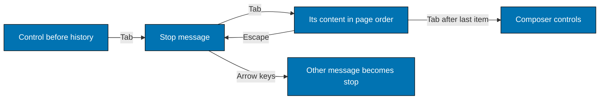

# 003. Inline Chat Images And One Markdown Renderer For Both Chat Rooms

Date: 2026-11-10

Status: Accepted (2026-11-11). The owner asked for inline images in both chat rooms, one shared renderer, Mermaid
diagrams, and a polished responsive UI, and confirmed the third-party image privacy tradeoff of Decision 1.

Supersedes in part [002](002-codex-chat-markdown-and-images.md): the `https` and `data:` rows of Decision 2, Decision 5
(its statement that no Content-Security-Policy exists was incomplete), and items 1 and 7 of "Differences from the
original request". It also replaces the instruction text of 002 Decision 3 and the `ChatLive` markup wiring of 002
Decision 4 (now the shared component). Everything else in 002 stays in force (renderer choice, repository image route,
size and signature rules, threat rows not named here).

Extended by [004](004-mermaid-diagrams-in-both-chat-rooms.md): `mermaid` fences, the diagram engine, and the shared chat
stylesheet (004 refines item 6 of the browser rules below: the dark own-bubble colours come from shared variables).

Revised 2026-11-11, before release. Two decisions changed, on the owner's instruction: (1) Decision 6 replaces the rule
that links, wide tables, code blocks and diagrams in a Family Chat message are never keyboard stops (it failed WCAG
2.1.1); (2) the two-release plan (A then B, then 004's C) is replaced by one release with everything (section "Rollout
and rollback"). The Codex instruction text in Decision 4 now quotes `priv/codex/chat_instructions.mjs` exactly, with the
owner-approved SVG wording.

## Context

The owner wants two things:

1. Images in a Codex reply in `/chat` show inline as real `` elements, not only as a link.
2. The Family Chat room renders its messages as Markdown with the same formatting and the same image behaviour, through
   one shared renderer and one shared piece of markup, not two copies.

Facts checked in the code on 2026-11-10:

- Before this change, `BnestAppWeb.ChatMarkdown` (MDEx GFM, AST gate, ammonia allowlist, `auto_close` while streaming)
  turned an `https` image into a link (`alt (image not shown)`) and any other non-repository image into
  `[image not shown: alt]`. A repository image became `/chat/images/<path>`. `ChatLive` wrapped the result in
  `<div class="message-content markdown-body" data-role="assistant-message" ...>`. Only the `https` rule and the
  `data:` rule change here; `http` images stay links.
- Family Chat is not a LiveView. `FamilyChatController.room/2` renders an empty shell. The message list is built in the
  browser. Before this change, `assets/js/family_chat/message_render.js` created
  `<p data-role="family-chat-message-body">` and set `textContent`. Messages arrive as GraphQL data
  (`familyChatMessages` query, `sendFamilyChatMessage` mutation, `familyChatMessageCommitted` subscription). All three
  use the single field list `MESSAGE_FIELDS_BASE` in `assets/js/family_chat/operations.js`. As built, the body element
  now comes from `assets/js/family_chat/message_body.js` (`textBodyNode`, `committedBodyNode`, `rawBodyOf`), and
  `message_render.js` carries the `bodyHtml` field of a message and calls those functions.
- IndexedDB (`persistence_indexeddb.js`) stores only outbox rows (`body`, status, retry data). It never stores a
  committed message. No other code stores message bodies. The service worker never caches a page or a GraphQL answer.
  So no rendered HTML is stored on a device today.
- A Family Chat body is at most 4,000 graphemes and 16 KiB (`Domain.Message.normalize_body/1`). The quote preview
  (`body_preview`, 160 graphemes) is cut on the server and is plain text. There is no automated reply bot.
  `BNEST_FAMILY_CHAT_REPLY_ENABLED` switches the quote-a-message feature, not a bot. System messages come only from
  `FamilyChat.post_system_message/3`, an internal call with no caller in `lib/` today.
- Before this change, "Copy text" and "Reply" read the body back with `textContent` of the rendered body
  (`mount_browser_actions.js`, `messageFrom/1`); they now use `rawBodyOf` (browser rule 4). The arrival announcement (`announceArrival`) uses `message.body`.
- `roving_focus.js` holds the history to one tab stop and its invariant check counts any `a[href]`, `input` or
  `[tabindex]` inside a message that has `tabIndex >= 0`. Before the 2026-11-11 revision, `message_body.js` set
  `tabIndex = -1` on every link and checkbox, `diagram_figure.js` (`focusable: false`) did the same for a diagram's canvas
  and "Diagram source" summary, and nothing set `tabindex` on a table or code block. Result (review finding FC-02): a
  keyboard-only reader could not reach a link, a wide table, a wide code block, a scrolled diagram or the diagram
  source in a Family Chat message (WCAG 2.1.1 Keyboard). Decision 6 fixes this.
- A message from the signed-in member ("own") has a dark bubble (`--bnest-ink-soft` background, paper text). The
  `.markdown-body` colours (link `--bnest-ink-soft`, headings `--bnest-ink`) would be unreadable on it.
- Security headers: `put_secure_browser_headers` (router `:browser` pipeline) sends
  `content-security-policy: base-uri 'self'; frame-ancestors 'self';` plus `referrer-policy`, `x-content-type-options`
  and `x-permitted-cross-domain-policies`. It has no `img-src` and no `default-src`, so the browser does not restrict
  image sources on any page. `tools/caddy-config.mjs` only does `reverse_proxy` and `header_up`; it adds no response
  header. `endpoint.ex` and `ReleaseHeaders` add only `x-bnest-revision`. 002 said "no CSP anywhere"; the accurate
  statement is "a CSP with no `img-src`". Only the image route sets its own `default-src 'none'; sandbox` (for the image
  response itself, which does not affect embedding).
- The service worker (`priv/static/service-worker.js`) handles `fetch` for every GET from a controlled page. Its
  `cacheable` test looks at the path only (`/assets/` or `/images/`), not the origin. A third-party image whose path
  starts with `/images/` would be fetched and passed through by the worker. The response of a no-cors image is opaque
  (`response.ok` is false), so it is not cached, but the worker still sits in the request path. `/chat/images/...`
  does not match the test and goes straight to the network.
- Authorization. `GET /chat/images/*path` is in the `[:browser, :authenticated_browser]` scope: any signed-in session,
  no role check, no Family Chat flag. `/chat` needs the same. Family Chat needs the same session, the
  `family_chat_enabled` route flag, and the GraphQL capability `use_family_chat`, which `Identity.Domain.Authorization`
  grants to a user with a non-empty list of valid roles (`children`, `parents`, `admin`) for their own user id. Every
  account that passes the Family Chat check also passes the image route check. The repository directory is the one
  configured checkout, not a per-user value.

## Decision 1. Show `https` images and small raster `data:` images inline

The owner decided that an image in a reply or message is displayed, which reverses the 002 rule that external and
`data:` images are never loaded.

**Privacy tradeoff, confirmed by the owner.** When a message with an `https` image is displayed, the viewer's browser
sends a request to the host named in the URL. That host learns the viewer's IP address, the time, the browser and the
device, and sees anything written into the URL. A prompt-injected or confused model could write a repository secret
into the query string of such a URL, and in Family Chat any member (or anyone who controls a member's account) can
choose the host. Loading is silent and needs no click. Children read these rooms. The owner accepts this for the value
of seeing images. The mitigations that stay are listed in the threat table; none of them removes the request.

### Classifier rules (`BnestAppWeb.ChatMarkdown.classify_image/1`)

The order is fixed. The first matching row wins.

| Order | Destination                                                                                                                                                                                             | Result                                                             |
| ----- | ------------------------------------------------------------------------------------------------------------------------------------------------------------------------------------------------------- | ------------------------------------------------------------------ |
| 1     | Repository reference accepted by `RepositoryImage.reference/1` (unchanged)                                                                                                                              | `{:repository, path}` and the route URL, as now                    |
| 2     | Scheme `https`, at most 2,048 characters, a host, no user info, no control or space characters                                                                                                          | `{:external, url}` and an inline ``                           |
| 3     | Scheme `http`                                                                                                                                                                                           | `:link_only`: a link `alt (image not shown)`, as now. Reason below |
| 4     | `data:image/{png,jpeg,gif,webp};base64,<payload>`, payload at most 32,768 base64 characters, valid base64, decoded bytes pass `RepositoryImage.signature/1` and the signature matches the declared type | `{:inline, url}` and an inline ``                             |
| 5     | Everything else (`data:` of any other type including `image/svg+xml`, an oversized or invalid data payload, `javascript:`, `//host`, relative paths that fail rule 1, other schemes)                    | `:other`: `[image not shown: alt]`, as now                         |

Why `http` stays a link: the app is served over `https` (Caddy sets `X-Forwarded-Proto https`; tailnet access is
`https`). A browser blocks or silently upgrades an `http` image on such a page, so an `` would be broken or would
load a different resource than the one written. A visible link is the honest result.

Why 32,768 base64 characters (about 24 KiB decoded): enough for icons, QR codes, charts and small screenshots, which is
what a model or a person can reasonably paste; small enough that a 100,000-byte Codex message holds a few images at
most and that one LiveView update stays cheap (each streaming update re-sends the whole reply HTML). Family Chat's own
body limit is stricter: a body is at most 4,000 graphemes (`@max_graphemes` in `Domain.Message`) and 16 KiB, and every
base64 character is one grapheme, so a data image there can have a payload of about 4,000 characters (about 3 KB
decoded) at most. The shared cap does not need a Family Chat special case. The cap is checked on the string length
before any decoding.

Why the signature check: comrak and the browser would let a wrongly labelled payload through to the decoder. Requiring
valid base64 and a matching PNG, JPEG, GIF or WebP signature reuses `RepositoryImage.signature/1`, costs a few
microseconds and keeps "raster only" true in one place.

Other rules:

- Output attributes stay `src alt loading=lazy referrerpolicy=no-referrer decoding=async`. No `title`, `width`, `height`
  or `srcset`.
- Rule 2 looks at the scheme, not the file type, so an `https` address that names an SVG file is shown too. The browser
  runs no script and loads no sub-resource for an SVG used as an ``, so this adds no script risk beyond the privacy
  tradeoff above; some hosts refuse to serve SVG to other sites, and then the browser shows its broken-image box with the
  alt text. SVG stays refused where the app itself would serve or embed the bytes: a `data:` address (rule 5) and a
  repository file (002, the extension allowlist and signature check).
- The renderer does **not** add a link around an image. A wrapper added by the app would create a nested link when the
  author already wrote `[](url)` and would add a tab stop per image. An author who wants a full-size link can
  write that form, and the Codex instruction tells Codex it may. The renderer then keeps exactly what the author wrote,
  and gates the outer link and the inner image on their own: with an `https` address in both places, the result is one
  `<a href=... target="_blank" rel="noopener noreferrer nofollow">` around one `` (a unit test pins this, with no
  nested link and no "image not shown" note). If the outer address has an unsafe scheme (for example `data:` or
  `javascript:`), the link becomes plain text and the image gate still decides the image on its own (a unit test pins
  that no link and no `data:` href come out for a `data:` wrapper). A wrapper whose inner image is an `http` address is
  not covered by a test. The CSS keeps `max-width: 100%` and `max-height: 28rem`.
- `ChatMarkdown` adds `data` to the sanitizer `url_schemes`. Ammonia has no per-tag scheme list, so the sanitizer can no
  longer reject a `data:` value in `<a href>`. The AST link gate (the `%Link{}` clause of `gate/3`) already turns every link whose
  scheme is not `http`, `https` or `mailto` into text, and raw HTML is escaped, so no `<a href="data:...">` can be
  produced. A unit test pins that fact (see Tests).
- While streaming (`auto_close: [links: :text, images: :text]`), an unfinished `` has arrived. A test pins
  this for `https` and `data:`.
- No host block list. A list of private names cannot stop a public DNS name that points inside a network, and an `https`
  image to an IP literal or a self-signed host does not load. The residual risk (a viewer's browser sends a GET to a
  host of the author's choice, including one on the viewer's network that has a valid certificate) is recorded and
  accepted with the privacy tradeoff. The existing rule that no GET route of Bnest changes state keeps a same-host
  address harmless.

## Decision 2. One renderer, one piece of markup, for both rooms

### Options for Family Chat

| Option                                                                 | Result                                                                                                                                                                                                                                                                                                                                                                         |
| ---------------------------------------------------------------------- | ------------------------------------------------------------------------------------------------------------------------------------------------------------------------------------------------------------------------------------------------------------------------------------------------------------------------------------------------------------------------------ |
| (a) A GraphQL field `bodyHtml` produced by the shared server component | Chosen. Same MDEx options, AST gate, sanitizer and markup as `/chat`. No new dependency, endpoint or route. The field arrives with the query, the mutation answer and the subscription push because all three use one field list. Cost: server CPU per requested message and a larger payload.                                                                                 |
| (b) A render endpoint the browser calls per message                    | Rejected. One extra request per message (or batch) with its own authorization, caching and failure states; pending-versus-arrived races; still needs the same server renderer, so it adds a second delivery path for nothing.                                                                                                                                                  |
| (c) A JavaScript Markdown library plus a JavaScript sanitizer          | Rejected. It is not one renderer: the rules (image classifier, scheme gate, sanitizer allowlist, size cap) would exist twice and drift. It needs two new dependencies (a parser and a sanitizer) where the repository already owns a vetted pipeline, which fails the first condition of [dependency selection](../../../repo-governance/development/dependency-selection.md). |

### Shared markup

New module `BnestAppWeb.ChatComponents` (`lib/bnest_app_web/components/chat_components.ex`) with the function component
`markdown_body/1`:

| Attr          | Type       | Default  | Meaning                                                         |
| ------------- | ---------- | -------- | --------------------------------------------------------------- |
| `content`     | `:string`  | required | Markdown source                                                 |
| `streaming`   | `:boolean` | `false`  | Passed to `ChatMarkdown.to_html/3` as `streaming?`              |
| `hard_breaks` | `:boolean` | `false`  | A typed single newline becomes `<br>`. Used by Family Chat only |
| `class`       | `:any`     | `nil`    | Extra classes after the fixed `message-content markdown-body`   |
| `rest`        | `:global`  | `%{}`    | `data-role`, `id`, `data-streaming`, `data-update-count`, ...   |

It renders `<div class={["message-content markdown-body", @class]} {@rest}>{ChatMarkdown.to_html(...)}</div>`.
`ChatLive` uses it for the assistant reply. The same module exports
`markdown_body_html(content, attrs) :: String.t()`, which renders the same component to a binary with
`Phoenix.HTML.Safe.to_iodata/1`. The GraphQL type calls only this function. A unit test renders both paths with equal
input and asserts byte-equal output; that test is the proof that there is one markup.

`ChatMarkdown.to_html/3` gains one option, `hard_breaks: boolean()` (default `false`, passed to comrak
`render: [hardbreaks: true]`). There is no `:context` (`:codex` or `:family`) option. Repository images are allowed in
both rooms by the same rule (Decision 5), so nothing else differs.

Why hard breaks for Family Chat: people type a line break on purpose and every stored message was shown with
`white-space: pre-wrap`. Standard Markdown joins single newlines, which would silently collapse old and new messages.
The Codex chat keeps standard behaviour (002, difference 5).

### GraphQL change

`FamilyChatTypes`, object `:family_chat_message`:

```elixir
field :body_html, non_null(:string) do
  resolve(fn message, _args, _resolution ->
    {:ok,
     BnestAppWeb.ChatComponents.markdown_body_html(message.body,
       hard_breaks: true,
       attrs: %{"data-role": "family-chat-message-body", class: "family-chat-message-body"}
     )}
  end)
end
```

(Shape only; the developer owns the exact syntax.) It is additive, so an older browser bundle never asks for it.
`:family_chat_message_quote` gets no such field: quote previews stay plain text. The renderer never raises; its
fallbacks (parse budget exceeded, invalid UTF-8) return the escaped body in a `<p class="whitespace-pre-wrap">`, so the
field is always a string.

### Browser rules

1. `MESSAGE_FIELDS_BASE` gains `bodyHtml`. One edit covers query, mutation and subscription.
2. A new module `assets/js/family_chat/message_body.js` is the **only** place that writes server HTML into the page. It
   parses with a `<template>` (inert: no script, no image request until it is adopted), accepts the result only when it is
   exactly one `div` with class `markdown-body` that holds no active element (`script`, `style`, `iframe`, `object`, `form` and similar) and no `on*` or
   `javascript:` attribute, sets `tabIndex = -1` on every `a[href]`, `input`, `table` and `pre` inside it (the history raises
   them only for the one stop message, Decision 6), and returns the element. On any mismatch, or when `bodyHtml` is absent, it returns the old text `<p>` built with
   `textContent`. It records the raw body in a `WeakMap` and exports `rawBodyOf(element)`.
3. A pending or failed outbox row always uses the text `<p>`. The committed copy replaces it when the mutation answer or
   the subscription push arrives (`reconcile` already does this). A queued message restored after a reload is text until
   it is sent.
4. "Copy text" and "Reply" use `rawBodyOf(element)` (fallback to `textContent`), not the rendered text, so copy gives
   the Markdown source the person typed. `announceArrival` keeps reading `message.body`: the live region stays plain text.
   The quote card and the reply strip stay plain text.
5. `bodyHtml` is never stored: `persistence_indexeddb.js` `toRow` keeps writing the existing fields only. A test pins
   it. Because nothing is cached, a sanitizer change cannot leave old HTML on a device. If a future change caches
   committed messages, it must cache `body` and re-fetch `bodyHtml`, or key the cache by a renderer version.
6. CSS. `.family-chat-message-body` loses `white-space: pre-wrap` for the Markdown element and keeps it for the text
   fallback (`[data-body-format="text"]`, set by `message_body.js`). Overrides for `.family-chat-message--own
.markdown-body` (links, headings, inline code, quote, table borders, checkbox, `del`) restore contrast on the dark
   bubble. The system bubble is checked by eye. The bubble already has `min-width: 0`; images use the existing
   `.markdown-body img` rule.

Trust in the browser: the HTML comes from the authenticated same-origin GraphQL answer and was produced by the same
escape, gate and sanitizer chain as `/chat`. The browser does not run a second sanitizer, because a second rule set is
exactly what Decision 2 avoids. The single insertion point, the `<template>` parse and the shape check limit what one
server bug can do; the server XSS corpus (002) is the control.

## Decision 3. Content-Security-Policy and the service worker

- **No CSP change.** The current policy has no `img-src`, so `https:` and `data:` images load on `/chat` and
  `/family-chat/:slug` without weakening anything. Adding `img-src 'self' https: data:` on those two routes would be a
  cheap defence in depth (it would also block `http:`, `blob:` and any other source if the sanitizer ever failed), but it
  needs a check of manifest icons, the theme script and LiveView's own requests, and it is not needed for the goal.
  Deferred; recorded here so the next change can pick it up.
- **Service worker.** `service-worker.js` makes `cacheable` also require `url.origin === self.location.origin`, and
  returns without `respondWith` for any other origin. This keeps third-party images out of the worker's request path,
  keeps them out of Cache Storage by rule rather than by the accident of an opaque response, and makes Playwright
  request interception work (`page.route` does not see requests a service worker makes). Cache name stays `v2`: the
  change adds no new cached item.

## Decision 4. The Codex instruction

`priv/codex/chat_instructions.mjs` changes to allow repository images and `https` images. The file is the source of
truth; the owner approved the SVG wording below on 2026-11-11 (prefer raster files, never a `data:` address for SVG, an
`https` SVG allowed with a warning that some hosts block it, never absolute paths or `http://` addresses):

```text
Write every reply in GitHub-flavored Markdown: short paragraphs, lists, tables, and fenced code blocks that name their
language. Never write raw HTML.
To show an image, use Markdown image syntax. Two kinds of image are displayed: a png, jpg, jpeg, gif or webp file that
exists in this repository, written as a path relative to the repository root, for example
; and a public image at an https:// address.
Check that a repository file exists before you point to it. Prefer png, jpg, jpeg, gif or webp files. Never use a data:
address for SVG. An SVG image at an https:// address is allowed, but some hosts may block it. Never use absolute paths
or http:// addresses. Never put text from this repository, secrets, or the user's words into an image address. If a
large image should open at full size, write it as a link around the image: [](address).
```

The text above is the two paragraphs this decision owns, shown with line breaks added for reading: in the file each
paragraph is one line, and the two are joined by a blank line. As built, `priv/codex/chat_instructions.mjs` holds these
two paragraphs word for word, followed by the diagram paragraph that
[004](004-mermaid-diagrams-in-both-chat-rooms.md), Decision 7 adds.

`chat_instructions_test.exs` keeps its contract tests (verbatim delivery through the installed CLI; runner passes
`config.developer_instructions`) and gains assertions on the new sentences ("Prefer png, jpg, jpeg, gif or webp", "Never use a data: address for SVG",
"An SVG image at an https:// address is allowed, but some hosts may block it", "Never use absolute paths or http://
addresses"; "never put ... into an image address").

## Decision 5. Authorization

`GET /chat/images/*path` stays in the `[:browser, :authenticated_browser]` scope with no role check. Result of the check
(see Context): every account that can see a Family Chat message (valid role list, own session, flag on) can load every
repository image that message names, so no "withheld" note or broken-image fallback is designed. A path that does not
exist shows the browser's broken-image box with the alt text, as in `/chat` today. Family Chat messages may therefore
contain repository images; this exposes nothing new, because any signed-in person can already request the same URL, and
the deny list, symlink, size and signature rules of 002 apply unchanged. The route does not look at which room or
message asked.

**Check-role result (verified in code and by a test).** Every Family Chat role (`children`, `parents`, `admin`) can
load `/chat/images/*` with a signed-in session. In `router.ex` the route sits in the scope
`pipe_through [:browser, :authenticated_browser]`, and the `:authenticated_browser` pipeline runs only
`require_authenticated_user`, which checks that a current user exists and looks at no role. The integration test
`test/integration/bnest_app_web/chat_image_controller_test.exs`, `describe "every Family Chat role"`, signs in one
synthetic member of each of the three roles and gets `200` with `content-type: image/png` for the repository logo.

## Decision 6. Keyboard reach of message content in Family Chat

Review finding FC-02 (WCAG 2.1.1 Keyboard, level A; the owner requires it to pass). The earlier rule "the history keeps
one tab stop, so nothing inside a message is a tab stop" left a keyboard-only reader with no way to follow a link, scroll
a wide table, code block or diagram, or open "Diagram source". The rule's goal was real (fifty messages must not be fifty
tab stops), but its means (nothing inside a message is ever reachable) was too strong. This decision keeps the goal and
changes the means. It replaces the old "extra tab stops break the keyboard model" statement.

### Options

| Option                                                                                                          | Result                                                                                                                                                                                                                                                                          |
| --------------------------------------------------------------------------------------------------------------- | ------------------------------------------------------------------------------------------------------------------------------------------------------------------------------------------------------------------------------------------------------------------------------- |
| (a) The stop message and its content form one tab group; every other message stays out of the tab order         | **Chosen.** Smallest change: the stop already exists, arrow keys and the `role="log"` list are unchanged, and a reader meets content the way they meet it on any page (Tab). Cost: Tab passes through the stop message's links and scroll regions before it leaves the history. |
| (b) Enter on a message enters a "content mode"                                                                  | Rejected. Enter and Space already open the action menu (Message actions rule), so a mode needs a new key, new state, an exit rule and its own announcements, and a reader must discover it. More code than (a) for the same reach.                                              |
| (c) "Open link" items in the message menu                                                                       | Rejected. Reaches links only, not a scroll region or "Diagram source"; the menu would grow with every link; it does not meet 2.1.1 for the other content.                                                                                                                       |
| (d) Every link and scroll region of every message is a tab stop                                                 | Rejected. This is the case the roving stop exists to prevent: Tab would walk the whole conversation (2.4.3 and 2.4.1 cost for 50 messages).                                                                                                                                     |
| (e) Leave scroll regions to the browser (Chromium 130 and later and Firefox make a scroller keyboard-focusable) | Rejected. Safari does not, and in Chromium it would also make every message's table a tab stop today unless `tabindex="-1"` opts it out. The app must say it explicitly in both directions.                                                                                     |

### The rule

1. **One tab group.** The history's tab order is the stop message (`tabindex="0"`, as today) followed, in page order, by
   its reachable content. Every other message, and everything inside it, has `tabindex="-1"`. Tab from the control
   before the history lands on the stop message. Tab again moves to the first item of its content, then the next, and
   after the last item Tab leaves the history to the next control (the composer side). Shift+Tab walks the same path
   backwards. Tab and Shift+Tab are never intercepted, so there is no keyboard trap (2.1.2).
2. **Reachable content** is looked for inside the stop message only, in these places, and nowhere else:

   | Content                                                                                    | Reachable when                                                                            |
   | ------------------------------------------------------------------------------------------ | ----------------------------------------------------------------------------------------- |
   | The quote card button (`.family-chat-message-quote`)                                       | always (it jumps to the quoted message; before this change it was pointer-only, same gap) |
   | `a[href]` inside `[data-role="family-chat-message-body"]`                                  | always                                                                                    |
   | `.bnest-diagram-source > summary` ("Diagram source")                                       | always                                                                                    |
   | `table`, `pre` (code block or diagram source) and `.bnest-diagram-canvas` inside that body | only while it overflows (`scrollWidth > clientWidth` or `scrollHeight > clientHeight`)    |

   Not reachable, on purpose: task-list checkboxes (disabled, read-only), the `⋯` actions button, the Retry and Discard
   buttons, and images. Each of the buttons has a keyboard equivalent that already exists: Enter or Space on the message
   opens the menu, which offers Copy text, Reply, Retry and Discard. A scroll region that does not overflow has nothing
   to scroll and is not a stop, so short code blocks add no stops.

3. **Tabindex values.** `message_render.js` still creates every message with `tabIndex = -1`.

   | Element                                                                     | Not the stop message   | The stop message               |
   | --------------------------------------------------------------------------- | ---------------------- | ------------------------------ |
   | The message (`li`)                                                          | `-1`                   | `0` (the one stop, as today)   |
   | Quote card, body links, "Diagram source" summary                            | `-1`                   | `0`                            |
   | `table`, `pre`, `.bnest-diagram-canvas`                                     | `-1` (always explicit) | `0` if it overflows, else `-1` |
   | Task checkboxes, `⋯` button, Retry and Discard, hidden diagram frame, `img` | `-1` (or inert)        | unchanged                      |

   A scroll region is set to `-1` explicitly and never left without a `tabindex`, because a browser that makes
   scrollers focusable would otherwise make it a stop in every message.

4. **Keys.** Arrow keys, Home and End move the stop, and Enter or Space open the menu, only when `event.target` is the
   message element itself (today the handlers use `closest(...)`, so they also fire for keys typed inside the content).
   When focus is inside the content, every key keeps its native meaning: Enter follows a link, Enter or Space toggles the
   summary, and arrows, Page keys, Home, End and Space scroll a focused scroll region. **Escape** inside the content moves
   focus to the message (`focus({ preventScroll: true })`) and has no other effect; from there the arrow keys work again.
   The document-level Escape handler of the open menu is unaffected, because the open menu holds focus outside the list.
5. **When the tabindex values are applied.** One function, `syncContentStops(items, stop)`, sets all of the table above and
   is idempotent. It runs: (a) inside `roving_focus.js` `applyStop()`, which already runs after every render path (initial,
   resumed, older, newer, pending, reconciled, remote arrival) through `withRovingRefresh`, and after `move()` and
   `moveTo()`; (b) on `focusin` inside the list, which re-measures overflow after a resize or a rotation; (c) on the
   `toggle` event (capture) of a `details`, because opening "Diagram source" shows a `pre` that may overflow; (d) from one
   `MutationObserver` on the list (`childList`, `subtree`, coalesced in a microtask), because a diagram is drawn into the
   message after render and `diagram_figure.js` creates it with `focusable: false`. The function sets only `tabindex` and
   (rule 7) `aria-label`; it adds or removes no node, so the observer cannot loop. It never moves focus.
6. **What happens when the list changes.** A new message arriving, an older page being prepended or a pending row being
   reconciled calls `refresh()`; the stop keeps its key, so the same message stays the stop and its content stays
   reachable. If the stop message is replaced under a new key, `applyStop()` falls back to the newest message, as today, and
   the content follows the new stop. A diagram finishing its draw in the stop message becomes reachable by rule 5(d). If
   the element that has focus is removed, the browser drops focus to the page, as it already does for a replaced message;
   this decision does not change that.
7. **Names and announcements.** Focusing the message reads its text as today; a link, a summary and the quote card keep
   their native names. A `pre` that becomes a stop gets `role="group"` and `aria-label="Code, scrollable"` if it has none;
   a `table` keeps its native role and, if it has no name, gets `aria-label="Table, scrollable"`; the diagram canvas
   keeps `role="img"` and its existing label. The arrival live region (`announceArrival`) is unchanged.
   The same names apply in the Codex room: `assets/js/scroll_region_names.js` names an overflowing table or code block
   there, and it sets the names only while the region overflows (004 Decision 8, step 4). The Codex names are set on
   the region, not on the message stops, because Codex has no roving stop.
8. **Focus indicator (2.4.7).** The rings for links, tables, code blocks, the canvas and the summary exist
   (`.markdown-body a|table|pre:focus-visible`, `.bnest-diagram-canvas:focus-visible`,
   `.bnest-diagram-source summary:focus-visible`). The coral ring (`#e5633d`) is only about 2.3:1 against the dark own
   bubble (`--bnest-ink-soft`), so inside `.family-chat-message--own` the ring colour is `--bnest-sun-light` (about 5.0:1).
   Coral is 3.4:1 on the white other bubble and 3.2:1 on paper, which passes; the system bubble is checked by eye.
   Under 004 Decision 6 this is the variable `--chat-focus-ring`, set once per bubble kind. The ring must not be clipped
   by the bubble; check it by eye at 320 and 390 px.
9. **Own-message actions and the Codex chat.** The `⋯` button stays `tabindex="-1"` and outside the content set, so a
   keyboard reader meets no extra stop per own message; its function stays on Enter, Space and the context-menu key. The
   Codex chat (`/chat`) is a LiveView in the normal document tab order: links, the diagram canvas (`focusable: true`) and
   "Diagram source" are ordinary tab stops there, and nothing in this decision changes it. (Wide tables and code blocks in
   `/chat` rely on the browser's own focusable scrollers, which Safari lacks; see open point 7.)



### Standards check

| Criterion                 | How the rule meets it                                                                                                                                                          |
| ------------------------- | ------------------------------------------------------------------------------------------------------------------------------------------------------------------------------ |
| 2.1.1 Keyboard            | Every link, scroll region, the diagram source and the quote card of a message can be reached with Tab and used with the native keys. The menu actions stay on Enter and Space. |
| 2.1.2 No keyboard trap    | Tab and Shift+Tab are not handled. Escape is an extra shortcut back to the message, never the only way out.                                                                    |
| 2.4.3 Focus order         | Page order: message, then its content, then the next control. The tab group is the same group that the DOM presents; no positive `tabindex`.                                   |
| 2.4.7 Focus visible       | Existing rings, with a contrast-safe ring on the own bubble (rule 8).                                                                                                          |
| 1.4.11 Non-text contrast  | The ring is at least 3:1 against its bubble (about 5.0:1 on the own bubble).                                                                                                   |
| 4.1.2 Name, role, value   | A scroll region that is a stop has a role and name (rule 7).                                                                                                                   |
| Screen readers            | Browse mode is unchanged (all content stays in the accessibility tree; only the tab order changes). `role="log"` and the live region are untouched.                            |
| The existing roving model | Still exactly one reachable message at a time. What changes is that "reachable inside a message" is no longer always empty: it is empty for every message except the stop.     |

### Implementation outline (swe-developer; test first)

Files under `apps/bnest-app/assets/js/family_chat/`:

- **New `message_content_stops.js`.** Exports `CONTENT_SELECTORS` and `syncContentStops(items, stop)`: every item gets its
  content set to `-1`; the stop's content is raised by rule 2, measuring overflow only for the stop's scroll regions;
  adds the `role` and `aria-label` of rule 7. Pure DOM, no timers.
- **`roving_focus.js`.** `applyStop()` calls `syncContentStops`. `createRovingFocus(list)` registers the `focusin` and
  `toggle` (capture) listeners and the coalesced `MutationObserver` of rule 5, and returns a `disconnect()` for tests. `move()` focuses the target with `preventScroll` and then calls
  `revealInHistory` (`focus_reveal.js`) on the history scroller, so the focused message is scrolled into the window: a
  message above or below the window goes to its near edge, and a message taller than the window aligns its top.
  `rovingInvariantHolds(list)` becomes: exactly one item with `tabIndex === 0`, no item with `tabIndex > 0`, no
  tabbable element inside a non-stop message, and inside the stop message only elements from `CONTENT_SELECTORS`
  (`tabbableInside` also looks at `table` and `pre`). Rewrite the header comment: "one tab stop" becomes "one tab group".
- **`message_body.js`.** At adoption, `-1` on `a[href], input, table, pre` (adds `table` and `pre`); update the comment.
- **`mount_browser_actions.js`.** In `bindMenuTriggers` (Enter and Space) and `bindRovingKeys`, act only when
  `event.target` is the message element (this replaces the `MANUAL_ACTIONS_SELECTOR` guard, since Retry and Discard are
  inside the message). Add the Escape handler of rule 4 to `wireMessageActions`.
- **`message_quote_render.js` and `message_render.js`.** Comments only; the initial `tabIndex = -1` stays.
- **No change under `assets/js/diagrams/`.** `observeDiagrams(history, { focusable: false })` and `setFocusable(false)`
  keep their meaning, "created as not tabbable"; the history raises them for the stop message. Only the doc comment of
  `setFocusable` should stop saying "one tab stop per history".
- **CSS.** The own-bubble focus ring of rule 8 is the variable `--chat-focus-ring`: `chat_shared.css` sets its default, and `app.css` sets it to `--bnest-sun-light` for the own bubble (004 Decision 6).

Tests, in this order. Vitest (happy-dom has no layout, so a test sets `scrollWidth` and `clientWidth` with
`Object.defineProperty`): `message_content_stops.test.ts` (each row of the tabindex table; overflow on and off; names);
`roving_focus.test.ts` (the invariant for the stop with and without content; `move()` and `moveTo()` switch which
message's content is raised; an appended diagram figure is picked up by the observer; `toggle` re-measures; fifty messages
with links have only the stop's content raised); `message_body.test.ts` (`table` and `pre` get `-1`); a test of the
key handlers (Enter on a link does not open the menu, an arrow key on a scroll region is not prevented, Escape returns
to the message, Enter on the message still opens the menu). Behaviour bindings in
`assets/test/behaviour/family_chat_markdown.steps.ts`, `family_chat_diagrams.steps.ts` and
`family_chat_reply.steps.ts`; Playwright steps in `apps/bnest-app-fe-e2e/tests/steps/family-chat-markdown.steps.ts`
and `family-chat-diagrams.steps.ts` (real focus and real overflow); `behaviour-coverage.json`. Run the existing
"Message actions", "Keyboard reach of the message history" and "Reading a reply" scenarios again: the stricter key
rule changes what a key typed on a quote card or on Retry does (it now acts natively).

### Gherkin changes (`specs/apps/bnest/app-fe/behaviours/family_chat.feature`)

Existing scenarios that change:

1. `Links in a message open in a new tab and add no tab stop` becomes `Links in a message open in a new tab`. Remove the
   step `And the message adds no tab stop`; update its `# Exemption(integration)` comment (it names the scenario).
2. `A diagram adds no tab stop to the history` becomes `A diagram in another message adds no tab stop to the history`.
   The Given sends the diagram message and then a plain message, so the newest message is the stop and the diagram
   message is not; the step `And the diagram adds no tab stop` becomes `And the diagram message adds no tab stop`. Update
   the exemption comment.
3. `Tab does not walk through every message in the room`, `The whole journey works from the keyboard alone` and the
   Outline `The room remains keyboard operable and free of horizontal scroll` keep their text. Check that the bindings of
   "every control is reachable by keyboard" do not treat links inside messages as controls that plain Tab must reach.

New Rule `Keyboard reach of message content` (each scenario with `@fe-vitest-unit`, `@integration-exempt` and the
standard exemption comment pointing at the Playwright scenario of the same name):

1. `Tab moves from a message into its links and opens one`: Tab from the control before the history lands on the newest
   message; Tab lands on the first link, Tab on the second; Enter on the second opens its address in a new tab and no
   action menu opens.
2. `Tab and Shift+Tab pass through message content without a trap`: Tab past the last link lands on the first control
   after the history, with no other message and no actions button focused on the way; Shift+Tab returns to the last link
   and then to the message and the control before the history.
3. `Escape returns focus from message content to the message`: from a link, Escape focuses the message; ArrowUp then
   focuses the previous message.
4. `Keys inside message content keep their own meaning` (Outline): Enter on a link follows it; Enter and Space on "Diagram
   source" toggle it; ArrowRight on a wide table scrolls it; in every case the stop does not move and no menu opens.
5. `A wide table or code block can be scrolled from the keyboard` (Outline over table and code block, mobile 390x844):
   Tab reaches the block, the focus ring is visible, ArrowRight scrolls it, focus stays on it.
6. `A table or code block that fits is not a tab stop`.
7. `Only the focused message's links are reachable`: fifty messages each with a link; the keyboard visits the newest
   message and its link only; ArrowUp on the message moves the stop, and then Tab reaches the older message's link and not
   the newest one's.
8. `A new message keeps the focused message's content reachable`: a message arrives live while focus is on the newest
   message; Tab still reaches that message's link.
9. `The diagram source opens from the keyboard`: Tab reaches "Diagram source", Enter shows the source, Tab continues.
10. `A scrolled diagram can be scrolled from the keyboard` (320 px viewport, so the picture is narrower than its natural
    size): Tab reaches the diagram, ArrowRight scrolls it.
11. `The quote card can be used from the keyboard`: Tab reaches the quote card of a reply, Enter jumps to the quoted message
    and moves the stop there.

`chat.feature` (Codex chat) and the back-end features do not change.

## Threat notes (modeling-threats)

**Assets:** viewers' privacy (IP, activity, device), children as readers, the session and rendered page, the
repository checkout, availability.

**Trust boundaries:** model output and member-written text (untrusted) to `ChatMarkdown`; server HTML to the browser
DOM; the viewer's browser to a third-party host; the browser to the image route.

**Entry points added or changed:** `ChatMarkdown` image rules; GraphQL field `bodyHtml`; `message_body.js`; the
service worker `fetch` handler; the Codex instruction.

| Threat                                                                           | Choice that closes or limits it                                                                                                           | Test that fails without it                                                                                                                                                                                                  |
| -------------------------------------------------------------------------------- | ----------------------------------------------------------------------------------------------------------------------------------------- | --------------------------------------------------------------------------------------------------------------------------------------------------------------------------------------------------------------------------- |
| Tracking and exfiltration through an `https` image URL                           | Accepted by the owner. Limited by the 2,048-character cap, no user info, the instruction text, `referrerpolicy=no-referrer`. Not removed. | Unit: 2,049-character URL and a URL with user info stay text                                                                                                                                                                |
| Script from member text or model text                                            | `escape: true`, AST gate, ammonia allowlist, same function for both rooms                                                                 | Existing XSS corpus runs with `hard_breaks` on and off, and through `bodyHtml`                                                                                                                                              |
| `data:` in `href` after `data` joins `url_schemes`                               | AST link gate and escaped raw HTML. Raw `<a href="data:...">` cannot be produced.                                                         | Unit: every corpus case yields no `href="data:`; autolink and `[x](data:image/png;base64,...)` are text                                                                                                                     |
| SVG or other `data:` types, oversized or mislabelled payload                     | Rule 4 type list, 32,768 cap checked before decode, base64 and signature check                                                            | Unit: svg, text/html, oversized, invalid base64, PNG label on JPEG bytes all give `[image not shown: ...]`                                                                                                                  |
| Half-written image URL while streaming                                           | `auto_close` images to text; image only after `)`                                                                                         | Unit: `![a](https://exa` and an unfinished data URI give no `` with `streaming? = true`                                                                                                                                |
| Mixed content                                                                    | `http` image stays a link                                                                                                                 | Unit and e2e: `http` image gives a link and no ``                                                                                                                                                                      |
| XSS through `innerHTML` of `bodyHtml`                                            | One insertion function, `<template>` parse, shape check, server chain; `bodyHtml` never stored                                            | Vitest: payloads with `<script>`, `onerror`, extra root nodes fall back to text; grep test: one `innerHTML` for server HTML                                                                                                 |
| Stale cached HTML after a sanitizer change                                       | Nothing caches `bodyHtml`                                                                                                                 | Vitest: `toRow` has no `bodyHtml`                                                                                                                                                                                           |
| Two renderers drift                                                              | One function component and one `markdown_body_html/2`                                                                                     | Unit: `~H` path and `markdown_body_html/2` give equal bytes                                                                                                                                                                 |
| Third-party request passes through the service worker                            | Origin check in `service-worker.js`                                                                                                       | Vitest `service_worker.test.ts`: a cross-origin `/images/x.png` GET is not intercepted and nothing is cached                                                                                                                |
| Message content unreachable by keyboard (WCAG 2.1.1), or Tab walks every message | One tab group: the stop message and its reachable content; every other message stays `-1` (Decision 6)                                    | Vitest: `rovingInvariantHolds` is true for the stop with links, tables and a figure and false for a reachable link in another message; e2e: Tab reaches a link, a wide table and the diagram source, and leaves the history |
| Wide image or table breaks the phone layout                                      | Existing `.markdown-body` rules, `min-width: 0` on the bubble                                                                             | e2e at 390 px: bubble `scrollWidth <= clientWidth`, image `naturalWidth > 0` and inside the bubble                                                                                                                          |
| Cross-member exposure of repository images                                       | Not new: the route already serves any signed-in person                                                                                    | Existing route tests                                                                                                                                                                                                        |
| Children shown an arbitrary remote image posted by a member                      | Accepted with the privacy tradeoff; the family trusts its members                                                                         | n/a (recorded; owner decision)                                                                                                                                                                                              |

## Tests and specs, in order

Spec first (Gherkin, bindings, Nx red, code, smoke), as the
[specification maintenance](../../../repo-governance/development/specification-maintenance.md) rule orders it.

`specs/apps/bnest/app-fe/behaviours/chat.feature`, Rule "Codex reply images":

- Rename `External and inline images in a Codex reply are not loaded` to
  `External https and small inline images in a Codex reply are shown`.
- Add `A Codex reply keeps http, svg and oversized images as text`.
- Add `A half-written image address in a streaming reply is not shown as an image`.
- Extend `Codex reply tables, task lists, links and images keep their layout` with a remote image and a 390 px check.

`specs/apps/bnest/app-fe/behaviours/family_chat.feature`, new Rule "Formatted messages":

- `A committed message is shown as formatted Markdown`
- `Raw HTML in a message is shown as text and never runs`
- `A message that is still sending is shown as typed`
- `Typed line breaks in a message are kept`
- `An https image in a message is shown inline`
- `A repository image in a message is shown inline`
- `Images a message may not show stay as text`
- `A formatted message that arrives live is formatted`
- `Links in a message open in a new tab` (Decision 6 removed `and add no tab stop` from the name)
- `A wide image or table fits a phone-width message`
- a second Rule, `Keyboard reach of message content`, with the scenarios and the scenario edits listed in Decision 6
- `Copying a formatted message copies what was typed`
- `Replying to a formatted message quotes plain text`

`specs/apps/bnest/app-be/behaviours/family_chat_graphql.feature`, new Rule "Message body as safe HTML":

- `A message carries its body as safe HTML`
- `Raw HTML in a message body is escaped in bodyHtml`
- `bodyHtml makes the same image decisions as the Codex chat`
- `A subscription push carries bodyHtml`
- `A quote carries a plain text preview and no HTML`

## Consequences

### Positive

- Images show inline in both rooms, with one renderer, one classifier, one sanitizer and one markup.
- No new dependency, no new route, no stored schema change, no new environment flag.
- Old bundles keep working: the field is additive and the browser falls back to text when it is missing.
- The Family Chat history meets WCAG 2.1.1 for links, scroll regions, the diagram source and the quote card, with one
  tab group and no keyboard trap (Decision 6).

### Negative

- The viewer's browser contacts third-party hosts (Decision 1). This cannot be undone by a later code change for
  messages already shown.
- Server cost: Family Chat renders Markdown for every message a page, mutation or subscription asks `bodyHtml` for. A
  50-message page of short messages costs a few tens of milliseconds; the adversarial maximum (50 messages of 16 KiB)
  is bounded by the 250 ms parse budget per message. Asking for `bodyHtml` under several aliases repeats that cost, so
  the GraphQL complexity budget prices each `bodyHtml` and refuses a page over its limit before it renders
  (`specs/apps/bnest/app-be/architecture.md`, Family Chat). Measure before adding a cache.
- Existing Family Chat messages that contain Markdown characters (`*`, `_`, a leading `1.` or `#`, `www.` addresses)
  now render as Markdown.
- Tab passes through the stop message's links, scroll regions and diagram source before it leaves the history (Decision
  6). A message with many links costs that many extra Tab presses on every pass through the history, and Shift+Tab from
  the composer lands on the last item of the stop message, not on the message. Accepted: the group is bounded by one
  message and the page order is predictable.
- The key handlers act only on the message element. A key typed on the quote card or on Retry or Discard now acts
  natively instead of opening the menu.
- The arrival announcement and the quote preview read the Markdown source, so an image-only message is announced as its
  source text.

### Rollout and rollback

One release with everything (owner decision, relayed 2026-11-11): the work packages of this record and of 004 (the
`ChatMarkdown` image rules, `ChatComponents`, the Codex chat, the instruction, the service worker origin check, the
`bodyHtml` field, `message_body.js`, `operations.js`, the keyboard-reach change, the CSS, Mermaid and its engine) ship
together, with no staged A and B releases and no feature flag. The earlier plan (release A with the server, release B
with the Family Chat bundle, release C for diagrams) is withdrawn.

Why one release is safe here: the browser bundle and the server that answers it come from the same revision, and Caddy
sends a page and its GraphQL calls to the same slot. An older open page that meets the new server keeps working because
`bodyHtml` is additive. The rollback floor is the revision before this release. Rolling back leaves an open Family Chat
page that already loaded the new bundle showing a GraphQL error (it asks for `bodyHtml`) until it is reloaded, and a
loaded `/chat` page shows diagram source with a note when the engine answers 404; neither changes stored data.

The deployer follows [live-service continuity](../../../repo-governance/development/live-service-continuity.md): start
the candidate on a loopback port, switch Caddy with a graceful reload, show the routed `x-bnest-revision` equals the new
revision, keep the previous backend through the bounded WebSocket drain, and let open `/chat` LiveViews and the Family
Chat socket reconnect on their own. Then, through the routed origin: fetch one real `bodyHtml`, load a real message with
an image in Family Chat, fetch `/assets/js/diagrams/engine.js` (200, JavaScript content type), and draw one real diagram
in each room. Commit and push are not deployment.

## Open points for the owner

What the branch does today is stated for each point. A point marked "open" has no recorded owner answer.

1. Hard breaks in Family Chat (Decision 2). Recommended: yes. Built: `hard_breaks: true` is passed for Family Chat only.
   The owner answer is not recorded here.
2. One release or staged releases. Decided by the owner on 2026-11-11: one release with everything, no new flag (section
   "Rollout and rollback").
3. Whether to add `img-src 'self' https: data:` later (Decision 3). Recommended: a separate change. Adopted for now: no
   policy change is in this branch.
4. Whether to wrap images in a link to the source. Recommended: not now. Adopted: the renderer adds no wrapper. An
   author, or Codex through its instruction, may write `[](address)`, and the renderer keeps that link
   (see Decision 1, "Other rules").
5. Click to open an image full size in both rooms. Not decided here. 004, Decision 6 and its open point 5 describe the
   design; no click handler exists in the branch, so this is a possible follow-up.
6. A dark chat theme. Not planned (004, open point 6); the chat has no dark values today.
7. Wide tables and code blocks in the Codex chat (`/chat`). They are not tab stops by this app's markup; they depend on
   the browser making a scroller keyboard-focusable (Chromium 130 and later, Firefox), which Safari does not. Recommended:
   a follow-up that runs the same overflow rule from the `ChatDiagrams` hook (`tabindex="0"` on an overflowing `table`
   and `pre`). Not in this release; Decision 6 changes Family Chat only.
