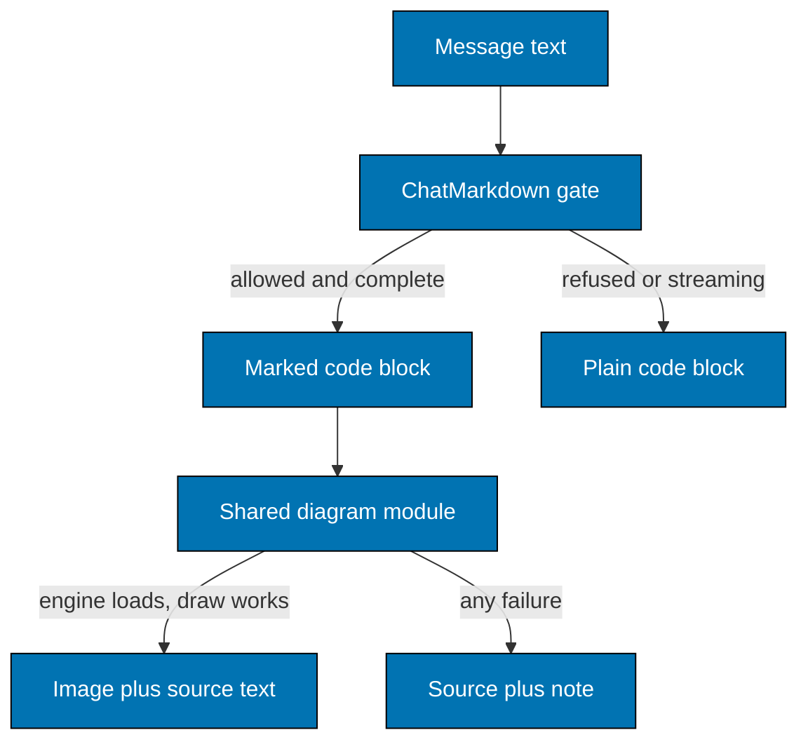

# 004. Mermaid Diagrams In Both Chat Rooms And One Shared Chat Stylesheet

Date: 2026-11-10

Status: Accepted (2026-11-11). The owner asked for Mermaid diagrams in both chat rooms and a polished responsive UI,
together with the inline images and the shared renderer of [003](003-inline-chat-images-and-shared-markdown.md), and
confirmed the third-party image privacy tradeoff recorded there.

Extends [003](003-inline-chat-images-and-shared-markdown.md). 003 stays in force. This record adds one fenced-code
language to the shared Markdown renderer, one new runtime dependency, and the CSS rule that keeps the two chat rooms
from drifting. It refines item 6 of the browser rules in 003 (how the dark own-message bubble gets readable colours).

Revised 2026-11-11, before release: Mermaid runs in a hidden same-origin frame, not in the page. Decisions 3 and 4, the
sandboxed-frame row in the output options, and the consequences changed. The reason and the measurements are in the last
Context fact. Everything else stays as first proposed.

Revised 2026-11-11, on the owner's instructions, also before release: (1) the diagram work no longer has its own
release C; everything ships in one release with 003 (section "Release"); (2) Family Chat no longer keeps diagram canvases
and "Diagram source" out of the keyboard order: 003 Decision 6 makes them reachable for the stop message, and
`focusable: false` now means "created not tabbable" (Decision 3); (3) Decision 6 is rewritten to state what the shared
stylesheet files hold today and the tasks that remain.

Revised 2026-11-11, before release, after the built code was checked against this record (the status stays Accepted):
(1) a failed engine start is no longer cached anywhere in the page's own code and is retried after the window
(Decision 3, "Where the engine runs"); the first start has its own limit, `engineStartTimeoutMs` (20,000 ms), and a draw
keeps `renderTimeoutMs` (8,000 ms); (2) the 1,500 ms figure is a reported target, not an asserted bound; the e2e bound is
28 s; (3) rule 5 of Decision 2 refuses a link or call word anywhere in the source, not only as the first word of a line;
(4) the text now says that drawing is lazy: a diagram is drawn only near the viewport.

Revised 2026-11-12, before release, after the built stylesheets and limits were checked against this record (the status
stays Accepted): (1) the server does not count edges; `ChatMarkdown.diagram_limits/0` holds the source size, line,
per-message and type rules, and the 60-edge cap is the browser engine's `maxEdges` (Decision 2, Decision 3, "Constants");
(2) the diagram picture's minimum width is 30 rem or 75 % of its natural width, whichever is larger (Decision 5,
"Layout"); (3) Decision 6 now states what `chat_shared.css`, `diagrams.css` and `app.css` hold and which of its tasks are
built.

## Context

The owner wants a fenced code block tagged `mermaid` to show as a drawn diagram (for example a flowchart) in the Codex
chat (`/chat`, a LiveView) and in Family Chat (browser-rendered from GraphQL `bodyHtml`), through the same shared
component `BnestAppWeb.ChatComponents.markdown_body/1` and `markdown_body_html/2`. Message text is untrusted: Family Chat
text comes from people, Codex text comes from a model that can be prompt-injected.

Facts checked in the code and measured on 2026-11-10:

- `ChatMarkdown` (MDEx 0.14.6) renders a fence as `<pre><code class="language-mermaid">`. The sanitizer allows `class`
  on `code` with any value, and no attribute on `pre`. Raw HTML is escaped (`escape: true`), so no `<pre>` can come from
  message text.
- `auto_close` (streaming) completes an unclosed fence by appending a closing fence before parsing. The AST then says
  `closed: true` for it. Without `auto_close`, `MDEx.CodeBlock.closed` is exact (`false` for an unclosed fence, a fence
  closed by a shorter run, and a fence ended by its container). So the AST cannot tell "closed" from "auto-closed" while
  streaming; the `streaming?` flag is the only reliable signal.
- `MDEx.traverse_and_update/3` carries an accumulator. `%MDEx.Raw{}` is rendered verbatim and then goes through the same
  sanitizer. An attribute listed only in `tag_attribute_values` (not in `tag_attributes`) is kept only for the listed
  values (probed: `data-bnest-diagram="evil"` is stripped, `"mermaid"` is kept, `onclick` is stripped). A traversal
  callback cannot return two nodes.
- `ChatLive` renders `@chat.messages` with a plain `:for` (no stream). Each message is a `%{id: pos_integer, ...}`. The
  assistant body `div` has no `id` today. LiveView 1.2.9 morphs the whole container on every patch, so a node a script
  added or replaced (an SVG, an opened `<details>`) is reverted by any later patch, including a patch caused by a
  different message streaming. Only `phx-update="ignore"` (which needs an `id`) stops that.
- Family Chat is not a LiveView; its history is built by `assets/js/family_chat/*`. `roving_focus.js` keeps one tab stop
  in the history and counts `a[href]`, `input` and `[tabindex]` inside a message that has `tabIndex >= 0`. As first
  proposed, no diagram part was reachable by keyboard there, which fails WCAG 2.1.1 (review finding FC-02); 003 Decision 6
  replaces that with one tab group per stop message.
- esbuild: `config :esbuild` has one profile `bnest_app` (`js/app.js --bundle --target=es2022 --outdir=../priv/static/assets/js`,
  default `iife`, no `--splitting`). With `iife`, a literal `import("mermaid")` would be inlined into `app.js`. Splitting
  needs `--format=esm`, which a classic `<script defer>` (root layout) cannot load, but a classic script can call
  `import(url)` on an ES module. Bare imports resolve by walking up to the repository `node_modules` (`phoenix` and
  `tailwindcss` already do). `mix assets.build` and `assets.deploy` list the profile by name; `dev.exs` has a watcher for it.
- Security headers: unchanged from 003 (`base-uri 'self'; frame-ancestors 'self'`, no `script-src`, `img-src` or
  `style-src`). The service worker (003) caches same-origin `/assets/` responses network-first and falls back to the
  cache; it precaches only `APP_SHELL` (no `/assets/js/diagrams/`). The server gives a
  content-hashed chunk (`chunks/<name>-<hash>.js`) a one-year `immutable` cache lifetime. The header is written when
  the response is sent, after `Plug.Static` writes its own, so it is not replaced (`BnestAppWeb.ImmutableChunks`). A
  file without a hash in its name gets no lifetime from it.
- One palette lives in `:root` of `chat_shared.css`, which `app.css` imports (`--bnest-ink #153f42`, `--bnest-ink-soft #205c5d`, `--bnest-canvas #d8f1ec`,
  `--bnest-paper #fff9ed`, `--bnest-sun-light #ffc966`, `--bnest-lagoon #80c5b8`, ...). The `data-theme=dark` variant
  exists only as a Tailwind variant; no chat rule has a dark value, and the theme dock is hidden on both chat pages.
  So the chat has no dark theme today.
- Mermaid has a record of XSS, CSS injection ("applying to sibling elements of the diagram"), prototype pollution and
  denial-of-service advisories (GitHub advisories page, the latest five published 2026-08-04; a critical XSS in
  architecture diagrams in 2025-08). The library is the highest-risk new input handler in the app.
- Drawing in the page is too slow (measured 2026-11-11). The e2e scenario "The largest allowed Codex flowchart is drawn
  within the time budget" (at that time asserted against 1,500 ms; that figure is now a reported target, see Decision 3)
  took 5.9 to 6.6 s for 60 edges in the app page, but about 0.5 s in a bare page. The
  cause is the page style sheet. It has `:has()` rules: the daisyUI theme rules
  `:root:has(input.theme-controller[value="dark"]:checked)` (from the `@plugin "daisyui/theme"` blocks in `app.css`) and
  `body:has(.home-shell) .theme-dock, body:has(.chat-shell) .theme-dock` (`app.css`, about line 273). The browser matches
  them again on every style update. Mermaid forces a style update for almost every label it measures (about 1,000 per
  60-edge draw), so the cost grows about with the square of the drawing size. A Chromium style-update trace of a 30-edge
  draw: 523 style updates touching 269,677 elements (1,800 ms) in the app page, against 4,982 elements (69 ms) with the
  `:has()` rules removed. An off-screen host element with CSS containment or `content-visibility` did not help, because
  the host stays under the document root. Emptying the message list did not help either.

## Decision 1. Threat model (STRIDE)

**Assets.** The signed-in session and the page (XSS); readers' privacy (third-party requests); the availability of the
reader's tab; children as readers; the repository content a model may quote.

**Trust boundaries.** Message text (untrusted) to `ChatMarkdown`; server HTML to the browser DOM (003); diagram source
(untrusted) to the Mermaid parser and layout code (new, third-party code); Mermaid's SVG string to the page (new).

**Entry points added.** The `mermaid` fence in `ChatMarkdown`; the marker `pre[data-bnest-diagram]`; the lazy ES module
`/assets/js/diagrams/engine.js` and its chunks; the hidden frame that runs them (Decision 3); `mermaid_diagrams.js`; the service worker's cache of the chunks.

| STRIDE | Threat                                                                                                                                                                               | Choice that closes or limits it                                                                                                                                                                                                                                                                                                                                                                                         | Test that fails without it                                                                                                                                 |
| ------ | ------------------------------------------------------------------------------------------------------------------------------------------------------------------------------------ | ----------------------------------------------------------------------------------------------------------------------------------------------------------------------------------------------------------------------------------------------------------------------------------------------------------------------------------------------------------------------------------------------------------------------- | ---------------------------------------------------------------------------------------------------------------------------------------------------------- |
| S      | A diagram imitates app UI (a fake "session expired, sign in" box) to phish.                                                                                                          | The diagram sits in a labelled figure with its own border, is an inert image (nothing in it is clickable or typeable), and a link cannot be made (no `click`, `href`, `call`, `callback` or `link` word, Decision 2 rule 5). Residual: looks can still mislead; accepted, same as an image today.                                                                                                                       | Vitest: drawn figure has no `a`, `input`, `button` inside the image box; Gherkin: hostile `click` lines are inert                                          |
| T      | Script or HTML in a label; a `click` handler; `%%{init}%%` or front matter that sets `securityLevel: loose`; `style`/`classDef` CSS that loads a URL or restyles the page.           | Server policy refuses `%%{`, shape data (`@{`), front matter, and the words `click`, `call`, `callback`, `href`, `link` and `links` anywhere in the source. Client config `securityLevel: "strict"`, `htmlLabels: false`, `secure` keys kept. The SVG is never inserted as DOM: it is shown through `` (Decision 3).                                                                   | ChatMarkdown unit (each refusal); Vitest: `mermaidConfig()` is strict; e2e: hostile corpus fires no canary, makes no request                               |
| R      | A member denies posting a diagram.                                                                                                                                                   | No change: the message and sender are recorded as before.                                                                                                                                                                                                                                                                                                                                                               | n/a                                                                                                                                                        |
| I      | The SVG fetches a remote image, font, stylesheet or `foreignObject` content, or Mermaid fetches an icon pack or external diagram; a request tells a host who is reading and when.    | An image loaded from a `data:` URL cannot load sub-resources or run script. Shape data (`@{ img: ... }`, which can name a remote picture) is refused by the server, and the frame's policy refuses a picture from another origin. The type allowlist drops diagram types that fetch icons (`architecture`). No CDN: the engine is bundled from our own origin.                                                          | e2e: every request in the diagram scenarios goes to the test origin; a request to a routed third-party host fails the scenario                             |
| D      | One hostile diagram freezes the tab (layout is synchronous and needs the DOM, so a Worker is not possible); many diagrams in one message or one page; a huge SVG; repeated failures. | Source, line and per-message caps on the server (Decision 2), edge and per-page caps in the browser (Decision 3, "Constants"), serialized draw queue, draw only near the viewport, timeout, SVG size cap, negative cache with a cool-down, lazy engine. Residual: the frame shares the page's thread, so one allowed diagram can still block the main thread for a second or so (60 edges: 342 to 682 ms in the frame). | Vitest: each cap and the timeout with a fake engine; e2e: a worst-case fixture draws or falls back inside the 28 s bound and the page stays responsive     |
| E      | A Mermaid or DOMPurify bug returns SVG that runs script on our origin (XSS to session).                                                                                              | Defence in depth: strict mode and Mermaid's own sanitizer, then an SVG shape guard that rejects `<script`, `<foreignObject`, `<iframe`, `<image`, tag attributes `on*=` and `javascript:`, then the `` sandbox, which runs no script even if all three fail. Pinned version.                                                                                                                                       | Vitest: guard rejects each pattern; grep test: no `innerHTML`, `insertAdjacentHTML` or `DOMParser` in `assets/js/diagrams/`; e2e: injection canary stays 0 |
| T/D    | Supply chain: about 115 transitive packages, a malicious or broken update.                                                                                                           | Exact version pin and lockfile; `npm ci` in CI; `npm audit` clean for the pinned version (0 found on 2026-11-10); no install scripts in the tree (checked); dependency choice recorded in Decision 5.                                                                                                                                                                                                                   | `npm ci` and the existing dependency checks; release build                                                                                                 |

Two choices matter most. First, the Mermaid output is shown as an image, not parsed into the page. This removes the
whole class "sanitizer bypass leads to XSS", the CSS injection that leaks to sibling elements, and any need for a
`style-src 'unsafe-inline'` allowance later. Second, the server decides which fences may be drawn, so the browser
receives the marker only for acceptable diagrams.

### Weighing the output options

| Option                                                                         | Result                                                                                                                                                                                                                                                                                                                                                                                                                                                                     |
| ------------------------------------------------------------------------------ | -------------------------------------------------------------------------------------------------------------------------------------------------------------------------------------------------------------------------------------------------------------------------------------------------------------------------------------------------------------------------------------------------------------------------------------------------------------------------- |
| Inline SVG from Mermaid `strict` output only                                   | Rejected. The security rests on Mermaid's sanitizer alone. Its `<style>` and `style=` output needs `unsafe-inline` for any future `style-src`. Known CSS-injection advisory.                                                                                                                                                                                                                                                                                               |
| Inline SVG plus a second DOMPurify SVG profile                                 | Rejected. Two sanitizers that must agree, a second copy of DOMPurify (Mermaid already bundles one), and still a script-capable context.                                                                                                                                                                                                                                                                                                                                    |
| Sandboxed `<iframe sandbox srcdoc>` with Mermaid inside, one frame per diagram | Rejected for v1. Strong isolation, but it loads the engine again per frame, cannot share the cache across messages, and does not give a reliable separate thread (opaque-origin iframes may share the thread in some browsers). Not the escalation that was built: the 2026-11-11 revision uses one hidden same-origin frame for the whole page, for speed and not for isolation (Decision 3).                                                                             |
| **``**                         | **Chosen.** An SVG image runs no script, loads no sub-resource, has no event handlers and no links, and its styles stay inside it. Cost: no text selection inside the diagram, no page CSS inside it (colours are resolved before drawing), `htmlLabels` must be `false` (Safari and `foreignObject` in images), the SVG must carry its own size. `blob:` was not chosen: it needs revoking and ties the lifetime to the page; `data:` is already needed for images (003). |
| Server-side render (`mermaid-cli`, headless Chromium)                          | Rejected. Needs a browser and Node on the server, a process per draw, a new availability and resource cost on a 24/7 service, and still returns SVG that must be sanitized.                                                                                                                                                                                                                                                                                                |
| A Web Worker                                                                   | Not possible: Mermaid layout needs DOM (`getBBox`). A timeout and caps are the substitute.                                                                                                                                                                                                                                                                                                                                                                                 |

## Decision 2. Server markup and caps (`BnestAppWeb.ChatMarkdown`)

The server turns a fence into a drawable marker only when all of these hold. The check lives in the AST gate, next to
the image gate from 003, so one pass does it.

| Order | Rule (first failing rule gives the reason)                                                                                                                                                                                                                                                                                                                              | Reason code    |
| ----- | ----------------------------------------------------------------------------------------------------------------------------------------------------------------------------------------------------------------------------------------------------------------------------------------------------------------------------------------------------------------------- | -------------- |
| 0     | `streaming?` is `true`: leave the fence as it is today, no marker, no note. It is drawn when the reply completes.                                                                                                                                                                                                                                                       | (none)         |
| 1     | Info string, first word, compared case-insensitively, is `mermaid`; otherwise the block is not ours.                                                                                                                                                                                                                                                                    | (not ours)     |
| 2     | `CodeBlock.closed == true`. A completed reply whose fence was never closed is not drawn.                                                                                                                                                                                                                                                                                | `:unfinished`  |
| 3     | `byte_size(literal) <= 6_000` and at most 200 lines (a trailing newline is not a line).                                                                                                                                                                                                                                                                                 | `:too_large`   |
| 4     | First non-blank, non-`%%` line starts with one of `flowchart`, `graph`, `sequenceDiagram`, `classDiagram`, `stateDiagram`, `stateDiagram-v2`, `erDiagram`, `pie`, `gantt` followed by a space or the end of the line. (`flowchart-elk` and others fail.)                                                                                                                | `:unsupported` |
| 5     | No `%%{` and no `@{` (shape data) anywhere, and none of the words `click`, `call`, `callback`, `link`, `links` or `href` anywhere in the source, as a whole word, in any case. A word ends at any character that is not a letter, a digit or an underscore. (Front matter starts with `---`, which is not a type word, so rule 4 already refuses it as `:unsupported`.) | `:not_allowed` |
| 6     | This is among the first 4 accepted diagrams of the message (document order, nested blocks count).                                                                                                                                                                                                                                                                       | `:too_many`    |

**Rule 5 in detail.** The first version of the rule looked only at the first word of each line. That left a bypass:
Mermaid accepts several statements on one line when `;` separates them, so `A-->B; click A "url"` is a link, and no line
starts with `click`. The gate now looks for the whole word anywhere in the source. The server (`not_allowed?/1` in
`chat_markdown.ex`) and the browser's copy (`NOT_ALLOWED_WORD` in `diagram_limits.js`) use the same pattern, so they
refuse the same sources, and both are tested (`chat_markdown_test.exs`, `diagram_limits.test.ts`; the drift test reads
only the shared numbers and cannot see this pattern).

- **Consequence.** A label that contains one of the words is refused too, with the source-and-note fallback: `A[Click here]`
  is `:not_allowed`, and so is a node named `link`. `linkStyle` is one word that is not `link`, so it passes. A word that
  only contains the keyword (`clicker`, `hrefs`) passes.
- **Alternative considered.** A tokenizer that knows Mermaid's quoting would refuse only a real statement and let
  `A["Click here"]` through. It was not chosen: it must copy part of Mermaid's grammar on the server and in the browser,
  and a gap in it would reopen the bypass. A refused harmless label costs the reader one fallback figure, so the
  simpler rule wins. A quote-aware tokenizer stays a possible follow-up, only if refused labels turn out to be common.

`diagram_limits/0` returns `%{max_source_bytes: 6_000, max_lines: 200, max_per_message: 4, kinds: [String.t()]}` and is
public so tests and the drift test read one source.

**The server does not count edges.** The server checks the source size, the line count, the diagrams per message, the
diagram type and the forbidden words (rules 3 to 6). It does not parse a diagram, so it cannot know how many edges one
has. The 60-edge cap is the browser engine's `maxEdges` setting (Decision 3, "Constants"; `engine_config.js` reads it from
`diagram_limits.js`). A diagram over the cap stays a valid marker, and the browser shows the source with the note "it is
too large" (reason `limits`). `diagram_limits/0` has no edge key, so the drift test does not compare edges.

**What the caps mean in each room.** The Codex chat accepts a message of up to 100,000 bytes, so every cap can be
reached there. A Family Chat body is at most 4,000 graphemes (`@max_graphemes 4_000` in `Domain.Message`, `message.ex`)
and 16 KiB. With ASCII text one grapheme is one byte, so a Family Chat diagram of plain ASCII is at most 4,000 bytes and
can never reach the 6,000-byte cap. An oversized Family Chat diagram by bytes needs multi-byte characters: 4,000
two-byte characters make about 8,000 bytes, which is still under the 16 KiB body cap. The 200-line cap can be reached
in Family Chat with short lines. The browser's copy of the checks (Decision 3) applies the same numbers in both rooms.

**Accepted** (replaces the `CodeBlock` with `%MDEx.Raw{}` built with `Phoenix.HTML.html_escape/1`):

```html
<pre data-bnest-diagram="mermaid"><code>flowchart TD
 A--&gt;B
</code></pre>
```

**Not accepted for a reason in rules 2 to 6** (also `%MDEx.Raw{}`; the code block is the one comrak would print, plus
a note that uses only allowed tags):

```html
<pre><code class="language-mermaid">…escaped source…</code></pre>
<p><em>Diagram not drawn: it is too large.</em></p>
```

Note texts: `:unfinished` "its code block was never closed"; `:too_large` "it is too large"; `:unsupported` "this diagram type
is not supported"; `:not_allowed` "it uses settings that are not allowed"; `:too_many` "only the first 4 diagrams in a message are drawn".

Sanitizer change: `@sanitize` gains `tag_attribute_values: %{"input" => ..., "pre" => %{"data-bnest-diagram" => ["mermaid"]}}`
and `"pre"` is **not** added to `@tag_attributes`, so the attribute exists only with that one value. No `id`, no
`phx-*`, no `class` on `pre` is allowed. The marker is a data attribute, not a class, because `code` keeps allowing any
`language-*` class from the author; the browser acts only on `pre[data-bnest-diagram="mermaid"]`.

Streaming: while `streaming?` is true the user sees the fence as an ordinary code block (auto-close already makes it
well formed). When the reply completes, the same message is re-rendered with `streaming? = false` and the marker
appears. Why not "draw each fence as soon as it closes": the AST cannot tell closed from auto-closed (Context), a second
parse without `auto_close` would be needed on every chunk, and every chunk would re-trigger drawing. Recorded as an
owner choice (open point 1).

`ChatComponents` does not change: both paths call `ChatMarkdown.to_html/3`, so the byte-equality test of 003 covers the
marker and a mermaid sample is added to it. `GraphQL bodyHtml` is produced with `streaming? = false`, so Family Chat
messages always carry the marker for acceptable diagrams.

## Decision 3. Browser: one shared module, one lifecycle, one insertion path

### Modules (all under `apps/bnest-app/assets/js/diagrams/`)

| File                    | Bundle        | Content                                                                                                                                                                                                                                                                                                                                                                                                                                                                                                                                                                                                                                                                                                                                                                                                    |
| ----------------------- | ------------- | ---------------------------------------------------------------------------------------------------------------------------------------------------------------------------------------------------------------------------------------------------------------------------------------------------------------------------------------------------------------------------------------------------------------------------------------------------------------------------------------------------------------------------------------------------------------------------------------------------------------------------------------------------------------------------------------------------------------------------------------------------------------------------------------------------------- |
| `diagram_limits.js`     | `app.js`      | `LIMITS`, `KINDS`, `diagramKind(source)`, `checkSource(source)`: a client copy of rules 3 to 5 (defence in depth; the server stays the authority) plus the browser-only numbers, among them `maxEdges`, which the server never checks. A drift test compares the shared numbers with `ChatMarkdown.diagram_limits/0`.                                                                                                                                                                                                                                                                                                                                                                                                                                                                                      |
| `diagram_theme.js`      | `app.js`      | `THEME_TOKENS`, `pageResolver`, `readThemeVariables(resolve)`: maps `--bnest-*` tokens to Mermaid `themeVariables` (Decision 5).                                                                                                                                                                                                                                                                                                                                                                                                                                                                                                                                                                                                                                                                           |
| `diagram_figure.js`     | `app.js`      | `svgToImage(svg)` (shape guard, size), `drawnFigure(...)`, `fallbackFigure(...)`, `setFocusable(...)`, `FALLBACK_NOTES`. Builds DOM with `createElement` and `textContent` only.                                                                                                                                                                                                                                                                                                                                                                                                                                                                                                                                                                                                                           |
| `diagram_draw.js`       | `app.js`      | `createDrawer(deps)`: one draw. It owns `loadEngine` (keeps a successful engine, the `ENGINE_API === 1` check, the `engineRetryMs` window after a failed start), the render timeout, the page cap `maxPerPage`, the call to `svgToImage`, and `DrawFailure` and `reasonOf`, which give the failure reason.                                                                                                                                                                                                                                                                                                                                                                                                                                                                                                 |
| `diagram_queue.js`      | `app.js`      | `createQueue`, `enqueue`, `place`: the serial draw queue that yields between draws, waiters per source, and the result cache (`cacheEntries`).                                                                                                                                                                                                                                                                                                                                                                                                                                                                                                                                                                                                                                                             |
| `diagram_browser.js`    | `app.js`      | `browserDeps()`: the real services (engine import from the `bnest-diagram-engine` meta tag, followed by a call to the module's `loadEngine()`, theme, timers, yield, `IntersectionObserver`). Only this module reads the page, so tests supply fakes.                                                                                                                                                                                                                                                                                                                                                                                                                                                                                                                                                      |
| `mermaid_diagrams.js`   | `app.js`      | `createDiagramRenderer(deps)` and the default instance. It finds the marked `pre` elements, admits them (`checkSource`, cache, queue), watches the viewport and the DOM, and exports `observeDiagrams(root, options)` and `drawDiagrams(root, options)`.                                                                                                                                                                                                                                                                                                                                                                                                                                                                                                                                                   |
| `chat_diagrams_hook.js` | `app.js`      | `export const ChatDiagrams` LiveView hook. Registered in `app.js` `hooks`.                                                                                                                                                                                                                                                                                                                                                                                                                                                                                                                                                                                                                                                                                                                                 |
| `engine_config.js`      | engine bundle | `LIMITS` (`maxTextSize`, `maxEdges`) and `mermaidConfig(themeVariables)`: a pure function returning the Mermaid config. Imported by `engine_core.js`, and by tests without loading Mermaid.                                                                                                                                                                                                                                                                                                                                                                                                                                                                                                                                                                                                                |
| `engine.js`             | engine bundle | The facade and the module the page imports. It holds no Mermaid code and exports `ENGINE_API = 1` and `loadEngine(): Promise<{ renderDiagram(source, themeVariables): Promise<{ svg: string }> }>`. It runs in two places. In the page, importing it starts nothing; the first `loadEngine()` call loads its own URL (`import.meta.url`) in the hidden frame through `loadEngineInFrame`, and the engine it resolves with is the frame's own `renderDiagram`. Calls made while a start runs share that start. In the frame, it imports `engine_core.js` and hands the engine to the frame element (`frameElement.bnestEngineHost`). A failed start rejects `loadEngine()` and is not kept, so the next call starts a new frame; the page still reports `unavailable` and keeps the `engineRetryMs` window. |
| `engine_core.js`        | engine bundle | The only file that imports `mermaid`. Exports `DiagramError` and `async renderDiagram(source, themeVariables)`; it runs only inside the frame (a lazy chunk of the engine bundle).                                                                                                                                                                                                                                                                                                                                                                                                                                                                                                                                                                                                                         |
| `diagram_frame.js`      | engine bundle | `loadEngineInFrame(doc, address, timers, accept)`, `HOST_PROPERTY` (`"bnestEngineHost"`) and the frame style. It creates the frame, loads the module into it, and resolves with the engine the frame hands over, if `accept` takes it. Only `engine.js` imports it. It reads `LIMITS.engineStartTimeoutMs` from `diagram_limits.js`.                                                                                                                                                                                                                                                                                                                                                                                                                                                                       |
| `elk_disabled.js`       | engine bundle | The stub that esbuild aliases in place of `elkjs` (Decision 4). It throws if it is called.                                                                                                                                                                                                                                                                                                                                                                                                                                                                                                                                                                                                                                                                                                                 |

`app.js` is the main bundle. The engine bundle is the second esbuild profile (Decision 4) and loads on demand. Its entry
is still `engine.js`; `engine_core.js` is a dynamic import of `engine.js`, so esbuild splits it (with Mermaid) into
chunks that only the frame loads.

`mermaidConfig`: `startOnLoad: false`, `securityLevel: "strict"`, `logLevel: "fatal"`, `suppressErrorRendering: true`,
`maxTextSize: 6000`, `maxEdges: 60`, `htmlLabels: false`, `flowchart: { htmlLabels: false }`, `layout: "dagre"`, the
`secure` key list (Mermaid's own keys plus `htmlLabels`, `flowchart` and `layout`, so a directive cannot change them),
`theme: "base"`, `themeVariables`, `fontFamily` = the resolved `--bnest-body` stack (must stay a system font stack: the
image cannot load web fonts, and Mermaid measures text with the font in its config, inside a frame that has no page style sheet). `renderDiagram` (in `engine_core.js`) first refuses a source
longer than `maxTextSize`, then calls `mermaid.initialize(config)`, then
`await mermaid.parse(source)` (a syntax error throws here, cheap), then `mermaid.render(uniqueId, source)`, and removes
any element Mermaid left in the frame's `document.body` in a `finally`. Verified in a scratch build with Chromium: `strict` turned
``, `<script>` and `<a href=javascript:>` labels into escaped label text, `click` lines gave no link, an
`%%{init: securityLevel loose}%%` directive still rendered a normal diagram (Mermaid protects its `secure` keys; the
server also refuses `%%{`), and a 99-edge chain took about 1.45 s (this scratch run was in a bare page, before the frame).

### Where the engine runs: a hidden same-origin frame

Mermaid draws by changing the DOM and measuring it hundreds of times. In the page, each measurement makes the browser
match the page's `:has()` rules again over every element below the root (Context), so a 60-edge draw took 5.9 to 6.6 s.
A frame has its own document with no style sheet, so the same draw is fast and no longer depends on the page's CSS.

- **The frame.** `loadEngineInFrame` in `diagram_frame.js` appends one `iframe` to the page body with
  `srcdoc` set to `<!doctype html>` followed by a `meta` element with the frame's Content-Security-Policy (standards mode, no `src`, so nothing is requested for it). It is off-screen
  (`position:fixed; left:-99999px`), `visibility:hidden`, `pointer-events:none`, `inert`, `aria-hidden="true"` and
  `tabindex="-1"`, and it has no style sheet. When the frame has loaded, the code adds
  `<script type="module" src="<engine.js address>">` to the frame document. There is no inline script. The frame stays
  while its start succeeds, because it holds the engine; a failed start removes it.
- **The hand-over.** In the frame, `engine.js` sees a `frameElement` that carries the `bnestEngineHost` property (set with
  `Object.defineProperty` on the frame element), imports `engine_core.js`, and calls `host.resolve(core)`. If that import
  fails, it calls `host.reject(error)` and does not throw at the top level, so the frame's own module does not stay
  failed; the page removes the frame on the report. In the page, `frameElement` has no such property, so `engine.js`
  takes the page branch: it exports `loadEngine()`, and the first call starts `loadEngineInFrame`. Importing the module
  alone starts nothing.
- **A failed start is not kept, and it is retried after the window.** `loadEngine()` resolves only when the frame has the
  engine. A frame that does not load (script `error` event, no frame document), a core that fails to load, a value that
  is not an engine (no `renderDiagram` function; the error is "the diagram frame gave no engine"), or no hand-over within
  `engineStartTimeoutMs` rejects the call and removes the frame. The module keeps nothing of the failure: `loaded` is set
  only after a success, and the shared attempt in progress is cleared when it ends. `diagram_draw.js` treats the
  rejection like any failed start: reason `unavailable`, and it remembers the time of the failure. Within `engineRetryMs`
  (30,000 ms) every draw reports `unavailable` without a new start; after the window the next draw calls `loadEngine()`
  again, which starts a new frame. Unit tests pin this (`engine_frame.test.ts`: "starts a second frame after a failed
  first start, so a later draw can succeed", "keeps a successful engine, so a later call starts no frame", "shares one
  attempt among calls made while it is starting"; `diagram_frame.test.ts`: the frame is removed on each failure).
  A failed fetch of `engine.js` itself is retried too: after a failed import the next call uses a retry address, because the
  browser's module map keeps a failed fetch for its exact address. The retry covers the frame, the core and its chunks.
- **Two time limits.** `engineStartTimeoutMs` is 20,000 ms. It covers the start of the engine: the frame and the chunks
  it fetches (about 1.4 MB on a slow phone), so it is long. It matters for the first start, because after a success the
  engine is kept. `renderTimeoutMs` is 8,000 ms and covers each draw once the engine is up. A cold first draw can
  therefore wait for both, 28 s at most; that sum is the bound the e2e scenario asserts (see "Measured" below).
- **Errors across the frame.** `DiagramError` is created in the frame's realm, so `instanceof` would fail in the page.
  `diagram_draw.js` already reads `error.name === "DiagramError"` and `error.kind`, which works across realms.
- **No change for the rest.** `diagram_browser.js` still imports `engineUrl` and now also calls the module's
  `loadEngine()`; `diagram_draw.js` keeps its `ENGINE_API` check, the `engineRetryMs` window and the per-draw timeout, and
  the SVG shape guard and `svgToImage` are unchanged. The page still gets Mermaid's SVG string and turns it into an ``.
- **Lazy as before.** The frame is created by the first `loadEngine()` call, which the first draw makes. A page with no
  marked diagram creates no frame and requests nothing. A page whose diagrams are all off-screen requests nothing either,
  because drawing is lazy (Lifecycle, step 3).

Measured on 2026-11-11 for the 60-edge fixture, from the marker to the picture in the page: 845 to 1,195 ms (five
Chromium runs 885 to 1,195 ms; mobile viewport 845 and 1,088 ms). Inside the frame, one render took 73 to 86 ms for 10
edges, 189 to 200 ms for 30 edges, and 342 to 682 ms for 60 edges. `maxEdges` (60) did not change.

**The 1,500 ms figure is a reported target, not a bound.** The e2e scenario "The largest allowed Codex flowchart is drawn
within the time budget" prints the time from marker to picture on every run, so a change to the caps is judged on a
measured number. It does not assert 1,500 ms, because a cold draw also includes the first engine start (the frame and
the chunks). The scenario asserts only the product's own limit for a cold draw, `DRAW_TIME_LIMIT_MS` = 28,000 ms
(`engineStartTimeoutMs` 20,000 ms plus `renderTimeoutMs` 8,000 ms). Reported by that scenario: about 1,475 ms in
Chromium and about 2,409 ms on the mobile viewport. So the mobile figure is above 1,500 ms, and the
earlier figures (845 to 1,195 ms) came from a different run. If the reported number grows, the rule under Constants below applies:
measure first, then lower the cap.

### Constants

`LIMITS = { maxSourceBytes: 6000, maxLines: 200, maxEdges: 60, maxPerMessage: 4, maxPerPage: 30, renderTimeoutMs: 8000,
engineStartTimeoutMs: 20000, maxSvgChars: 300000, cacheEntries: 24, engineRetryMs: 30000, prefetchMarginPx: 300 }`. In
plain words, the browser caps are: 60 edges per diagram, 30 drawn diagrams per page, an 8,000 ms render timeout for a
draw, a 20,000 ms limit for starting the engine, and 300,000 characters of SVG. `maxSourceBytes`, `maxLines` and
`maxPerMessage` repeat the server caps (`ChatMarkdown.diagram_limits/0`); `maxEdges`, `maxPerPage`, the timeouts and the
SVG and cache numbers are browser-only, and the server enforces none of them. `maxEdges` is enforced by Mermaid
(`maxEdges` in `mermaidConfig`); the 6,000-byte and 60-edge numbers are starting values: the e2e worst-case fixture is expected to draw in
about 1.5 s on the CI browser, the time is reported on every run, and the numbers are lowered if the report shows it
growing (measure first, do not guess). Result: in the page the fixture took 5.9 to 6.6 s; with the frame it draws in
about 0.85 to 2.4 s (see "Measured"), so both numbers stay.

### Lifecycle

1. `mounted()` (LiveView) or the Family Chat mount code calls `observeDiagrams(root, { focusable })`. It scans `root` once,
   then keeps one `MutationObserver` on `root` (`childList`, `subtree`, `attributes` with
   `attributeFilter: ["data-bnest-diagram"]`). The attribute filter is needed because LiveView turns a streaming code
   block into a marked one by patching attributes in place. Drawing a diagram adds a `figure`, which does not match the
   selector, so the observer cannot loop. It returns `{ disconnect() }`; `destroyed()` calls it.
2. For each `pre[data-bnest-diagram="mermaid"]` not already being drawn: `checkSource` (else fallback, reason
   `limits`); look up the cache by `themeSignature + "\n" + source`. A hit replaces the `pre` at once (no flash). A miss
   is queued.
3. The queue (`diagram_queue.js`) runs **one draw at a time** and yields to the event loop between draws. A diagram is
   queued for drawing only when it is within `prefetchMarginPx` of the viewport (`IntersectionObserver`, created in
   `mermaid_diagrams.js` through `browserDeps()`; when it does not exist, as in tests, draw at once). So drawing is
   lazy: a diagram that is further away stays a source marker (a `pre`, shown as an ordinary code block) until the
   reader scrolls within 300 px of it, and a page whose diagrams are all far away requests no engine. Tests that need the
   picture scroll first: the e2e step scrolls the last marker into view, and then waits for the pictures (28 s, the cold
   draw bound). A cached result and a refused source (`limits`) are placed at once, without waiting for the viewport.
   The page cap
   `maxPerPage`, kept in `diagram_draw.js`, counts drawn diagrams; beyond it a diagram stays as source with the
   `page-limit` note.
4. `loadEngine()` (in `diagram_draw.js`) keeps a successful engine. Otherwise it calls the `importEngine` service, which
   `diagram_browser.js` implements as `import(engineUrl)` followed by the module's own `loadEngine()`; that call
   resolves only when the hidden frame has the engine (see "Where the engine runs"). After a failed import the next call imports the same module under a retry address (`?retry=n`, `createEngineImporter`), because the browser's module map keeps a failed fetch for its exact address. `engineUrl` is read from
   `<meta name="bnest-diagram-engine" content="...">` (the root layout renders `~p"/assets/js/diagrams/engine.js"`, so
   the production URL carries the digest and a new release cannot pair an old cached entry with new chunk names). A
   failed start (limit `engineStartTimeoutMs`, 20,000 ms) is not kept by the engine module; `diagram_draw.js` remembers
   its time for `engineRetryMs`, and every diagram in that window falls back with reason `unavailable`. After the window
   the next draw starts the engine again in a new frame. The module checks `ENGINE_API === 1`.
5. A draw is the engine's `renderDiagram(source, theme)` (parse and render; the facade forwards it to the frame) raced against a timer of `renderTimeoutMs` (`withTimeout` in
   `diagram_draw.js`). A draw that times out discards the engine: its frame is removed (`discardEngine` in `engine.js`, `removeEngineFrame` in `diagram_frame.js`), so Mermaid's queue in that frame cannot block later draws, and the next draw starts a new frame. Only the page's timer ends a draw; the engine keeps no timer of its own. Results: `{ svg }` leads to `svgToImage` then `drawnFigure`; a thrown parse error gives reason
   `syntax`; edge or text limit gives `limits`; any other Mermaid failure gives `render`; a refused picture gives
   `unsafe`; the timeout gives `timeout`. Success and the failures that depend only on the source and the theme
   (`syntax`, `limits`, `render`, `unsafe`) are cached in `diagram_queue.js` (24 entries, oldest dropped).
   `unavailable`, `page-limit` and `timeout` depend on the moment and are not cached: a timeout was a slow draw on a busy
   device, and the next request for the source draws it again.
6. Before replacing, the code checks `pre.isConnected`. If the node is gone (a patch removed it) it only fills the cache.
7. The cache holds the built `figure` node. Placing it reuses the node when it is detached and clones it when it is
   already in the page (the same diagram posted twice), which avoids re-decoding the image. Either way the placed
   figure's source starts closed, so a figure that left the page with its source open does not come back open. In the
   Codex chat a picture is a keyboard stop only while it overflows its box; that is measured when it is placed and
   again whenever its canvas is resized (`measureOnResize` in `diagram_queue.js`).

### Markup produced (the only DOM the module writes)

Drawn:

```html
<figure class="bnest-diagram" data-bnest-diagram-state="drawn" aria-live="off">
  <div
    class="bnest-diagram-canvas"
    role="img"
    aria-label="Flowchart. The diagram source follows."
    [tabindex="0"]
  >
    
  </div>
  <details class="bnest-diagram-source">
    <summary>Diagram source</summary>
    <pre><code>…source…</code></pre>
  </details>
</figure>
```

Fallback (every failure):

```html
<figure
  class="bnest-diagram"
  data-bnest-diagram-state="fallback"
  data-reason="syntax"
  aria-live="off"
>
  <p class="bnest-diagram-note" role="note">
    Diagram not drawn: it has a syntax error.
  </p>
  <pre><code>…source…</code></pre>
</figure>
```

Reasons and texts (`FALLBACK_NOTES` in `diagram_figure.js`, in the same form as the server's refusal note,
"Diagram not drawn: <reason>."): `syntax` and `render` "it has a syntax error"; `limits` "it is too large"; `timeout`
"it took too long to draw"; `unavailable` "the diagram tool did not load"; `unsafe` "its picture failed a safety
check"; `page-limit` "only the first 30 diagrams on a page are drawn". The source is always set with `textContent`. `aria-live="off"` stops the Codex `aria-live="polite"` conversation from reading the
figure again when it is inserted. The accessible name comes from `diagramKind` ("Flowchart", "Sequence diagram", "Class
diagram", "State diagram", "Entity-relationship diagram", "Pie chart", "Gantt chart"); the source is real text inside
the figure for assistive technology and for copy. `focusable` is `true` in the Codex chat (the canvas gets `tabindex="0"`
only while it overflows, so a keyboard user can scroll it; "Diagram source" is a normal tab stop in the page order) and `false` in Family Chat.
There the figure is created with canvas and `summary` at `tabIndex = -1`, so no message but the stop message adds a tab
stop. The history then raises them: for the stop message only, "Diagram source" becomes `tabindex="0"` and the canvas
becomes `tabindex="0"` while it overflows, so a keyboard reader can open the source and scroll a wide picture (003
Decision 6, the one tab group of the stop message; `roving_focus.js` does this and also notices a figure that is drawn
after the message was rendered). `diagram_figure.js` needs no change for this.

### `svgToImage(svg)`

Accepts only a string at most `maxSvgChars` long that starts with `<svg`, has a `viewBox` with positive numbers, and
matches none of: `<script`, `<foreignObject`, `<iframe`, `<image`, `/<[a-z][^>]*\son[a-z]+\s*=/i`, `javascript:`. (A label
that contains the text `onerror=` is escaped by Mermaid to `&lt;...`, so it does not trip the tag pattern.) It returns
`{ src: "data:image/svg+xml;charset=utf-8," + encodeURIComponent(svg), width, height }` where width and height come from the
`viewBox`, clamped to 1 to 4000. Anything else throws and the caller uses reason `unsafe`.

### Where it plugs in

- Codex chat: `ChatLive` adds `id="chat-conversation"` and `phx-hook="ChatDiagrams"` to the `.conversation` div. Each
  assistant body gets `id={"assistant-message-#{message.id}"}` and `phx-update={if message.streaming, do: nil, else: "ignore"}`
  through the `rest` attribute of `markdown_body/1`. A finished reply never changes again, so ignoring it is lossless and
  keeps the drawn figure, an opened `<details>` and a scroll position through every later patch (including patches from
  the next reply streaming). The patch that ends streaming is not ignored yet (the old element decides), so the marker
  arrives and the observer draws. After "Clear chat" a new reply may reuse a message id; the clear patch removes the
  elements first, and a test pins that a diagram in the next conversation draws.
- Family Chat: `mount_browser.js` (function `wireDiagrams`) calls `observeDiagrams(elements.history, { focusable: false })`
  once and keeps the returned watcher (`focusable: false` means "created not tabbable"; the keyboard reach of a drawn figure is
  the history's job, 003 Decision 6). A `pagehide` listener (registered once) calls `disconnect()` unless the event
  has `persisted` set, so a page restored from the back-forward cache keeps its watcher. `message_body.js` stays the only place that
  writes server HTML (003); it needs no change, because the marker is plain markup and the observer finds it wherever
  the renderer puts it. "Copy text" and "Reply" keep using `rawBodyOf` (the Markdown source).
- Both: an `updated()` hook is not used. One mechanism (the observer) serves both rooms.

## Decision 4. Library loading and delivery

- **Package.** `mermaid@12.3.0`, exact pin, root `package.json` `dependencies`, license MIT. Published 2026-11-03; the
  project releases every few weeks (12.0.0 2026-09-10, 12.1.0 2026-10-02, 12.2.0 2026-10-13, 12.3.0 2026-11-03), has
  about 26 million downloads a week, and a maintained security-advisory process. `npm audit --omit=dev` found 0
  vulnerabilities. Transitive licenses: MIT, ISC, Apache-2.0, BSD-3-Clause, Unlicense, DOMPurify (MPL-2.0 or Apache-2.0),
  and `elkjs` (EPL-2.0 or GPL-3.0-or-later). `elkjs` is only used by Mermaid's optional ELK layout, which our allowlist
  and config never select, so the build aliases it to a stub (below): no EPL or GPL code ships, and about 1.5 MB leaves the output.
  Node engine `>=22.12` (the repository uses Node 24).
- **Why a dependency at all.** Dependency selection: the requirement (draw flowchart, sequence, class, state, ER, pie and
  Gantt from text, in the browser) cannot be met by a small repository-owned module without disproportionate cost; Mermaid
  is the established practice for this exact input format that models already write; it is actively maintained;
  it is a build-time bundled runtime dependency that needs no server code. Rejected: a hand-written flowchart-only
  drawer (covers one type, owns a layout engine); other text-to-diagram libraries (other text-to-diagram tools were not
  studied in depth: the ones that need a server or a WASM runtime fail the same cost test as server rendering, and none
  is the format models write by default);
  server-side rendering (Decision 1).
- **Bundle.** A second esbuild profile in `config/config.exs`:
  `bnest_app_diagrams: [args: ~w(js/diagrams/engine.js --bundle --splitting --format=esm --target=es2022 --outdir=../priv/static/assets/js/diagrams --chunk-names=chunks/[name]-[hash] --alias:elkjs/lib/elk.bundled.js=./js/diagrams/elk_disabled.js), cd: ..., env: ...]`
  (same `cd` and `env` as `bnest_app`). `elk_disabled.js` is a 2-line stub that throws. `assets.build`, `assets.deploy`
  (with `--minify`) and the dev watcher in `config/dev.exs` run it too. The profile does not touch `bnest_app`
  (which stays `iife`), so the main bundle and the classic `<script>` do not change. The static folder needs no change:
  `assets` is already in `static_paths/0`, and `phx.digest` already compresses and digests `.js`; chunk names carry a
  content hash and are imported relatively, so the originals that `phx.digest` keeps resolve. The 2026-11-11 revision
  needs no build change: the entry is still `engine.js`, and `engine_core.js` (with Mermaid) becomes a dynamic-import
  chunk of it. The `--format=esm` output keeps the top-level `await` of the frame branch in `engine.js` (target `es2022`). The page and the
  frame both request `engine.js` by the same URL; the page-side copy only runs the small facade.
- **Planning measurement (esbuild 0.25.4, `--minify`, scratch build, `elkjs` aliased).** Engine core 934 KB, 194 KB gzip (25 files);
  flowchart adds 441 KB / 134 KB gzip (shared layout code is counted here), sequence 212 / 63, class 378 / 113 (shares
  most of flowchart's layout code), state 369 / 110, ER 356 / 106, Gantt 143 / 48, pie 95 / 32. So the scratch
  build put a first flowchart at about 1.37 MB, 330 KB gzip. The tree has 107 chunk files, 3.9 MB on disk (types we
  never allow still ship as unused lazy chunks; deleting them is a later optimization with no behaviour change).
  Nothing loads until a message contains a marker. (These sizes are from before the frame; the frame adds no Mermaid
  code, only `engine.js`, `diagram_frame.js` and a copy of `LIMITS`.)
- **Measured in WP7 (the built bundle; replaces the estimates above).** `app.js` is unchanged at 196 KiB: the engine
  bundle adds nothing to it. The first flowchart load of the lazy engine is about 804 KiB raw and 224 KB gzip, fetched
  once and then served from the service worker cache. This measurement was taken in WP7, before the shared module of
  WP8 joined `app.js`; the final `app.js` size with `diagrams/*` is not recorded in this record.
- **No third-party request.** Nothing in this design contacts another origin, and two checks enforce it: the server and the browser refuse shape data (`@{`, which can name a picture), and the frame's own Content-Security-Policy refuses every request except its engine script from this origin and data pictures. The e2e scenarios fail on any non-test origin request, and a probe in the frame checks that a picture from another origin is refused.
- **Lockfile and Nx.** Run `npm install --save-exact mermaid@12.3.0` at the repository root (a workspace root; `apps/bnest-app`
  has no `package.json`), commit `package.json` and `package-lock.json`. No `project.json` change is needed:
  the Nx targets already run `mix assets.build`, which now builds both profiles, and CI already runs `npm ci` before it.
  The Vitest `coverage.include` in `assets/vitest.config.mts` gains `js/diagrams/**/*.js`. The `tsconfig`
  (`checkJs`, strict) must pass for the new files.
- **Content-Security-Policy.** The page sends no CSP header, so its own `script-src`, `img-src` and `style-src` are not set.
  The frame has its own policy, set by a `meta` element in its first markup: `default-src 'none'; script-src 'self';
style-src 'unsafe-inline'; img-src data:` (`FRAME_POLICY` in `diagram_frame.js`). The frame runs only the engine module
  from this origin, applies Mermaid's styles, shows data pictures and refuses every other request, including a picture
  from another origin. The e2e step "the picture loads nothing from another origin" checks this in Chromium. A future
  page-wide header needs `script-src 'self'` (plus the theme script's nonce or hash) and `img-src 'self' https: data:`;
  a `frame-src` or `child-src` would have to allow the `srcdoc` frame (document URL `about:srcdoc`).
- **Frame security.** The frame is not sandboxed and is same-origin, so a script in it could reach the page. That adds
  no new power: before the revision Mermaid ran in the page itself. The frame runs only our own bundle. Mermaid still
  runs with `securityLevel: "strict"`; its SVG string still goes through the shape guard (`svgToImage`) and is shown only
  as ``, so the image rule from Decision 1 does not change. The frame document has no
  style sheet, `inert`, `aria-hidden` and `visibility:hidden`, so readers and assistive technology never meet it.
- **Service worker (WP5).** `/assets/js/diagrams/**` already matches the same-origin `/assets/` rule, so chunks are cached
  as they are used (network first, cache on failure). They are not added to `APP_SHELL` (about 1.4 MB on every
  install). Offline behaviour: a diagram type viewed before still draws offline; a type never fetched falls back with
  reason `unavailable`. Because chunk names change with the content, the cache would grow with every release; WP5
  adds a trim: after a `put` under `/assets/js/diagrams/`, delete the oldest entries of that prefix beyond 120. The cache
  name stays `v2`. The service worker test gains: a diagrams path is cached; the 121st entry evicts the oldest; a
  cross-origin request is still not intercepted (003).

## Decision 5. Theme, layout and accessibility of the diagram

- **One surface in both rooms.** The figure always has its own `--bnest-paper` background, a `--bnest-ink-soft` border
  and the same radius, so it is readable on the Family Chat dark own bubble, the white other bubble and the Codex paper
  bubble without per-room rules.
- **Colours from tokens.** `readThemeVariables(env)` resolves each `--bnest-*` token to `rgb(...)` through a probe element
  (`color: var(--token)`), because Mermaid's colour code cannot read `var()` or `color-mix()`. The resolved values form
  `themeSignature`, which is part of the cache key, so a future token or theme change draws a new image on the next
  patch. Mapping (all text and fill pairs must reach 4.5:1; a Vitest test reads the hex values from `chat_shared.css` and checks):

  | Mermaid variable                                                                                                            | Token                                                                                                                                                |
  | --------------------------------------------------------------------------------------------------------------------------- | ---------------------------------------------------------------------------------------------------------------------------------------------------- |
  | `background`, `edgeLabelBackground`, `tertiaryColor`                                                                        | `--bnest-paper`                                                                                                                                      |
  | `primaryColor`, `mainBkg`, `clusterBkg`, `actorBkg`                                                                         | `--bnest-canvas`                                                                                                                                     |
  | `secondaryColor`, `noteBkgColor`                                                                                            | `--bnest-sun-light`                                                                                                                                  |
  | `primaryTextColor`, `secondaryTextColor`, `tertiaryTextColor`, `textColor`, `noteTextColor`, `actorTextColor`, `titleColor` | `--bnest-ink`                                                                                                                                        |
  | `primaryBorderColor`, `lineColor`, `nodeBorder`, `clusterBorder`, `actorBorder`, `actorLineColor`, `signalColor`            | `--bnest-ink-soft`                                                                                                                                   |
  | `pie1` to `pie6`                                                                                                            | `--bnest-lagoon`, `--bnest-sun-light`, `--sifat-mustahil`, `--sifat-wajib`, `--bnest-canvas`, `--bnest-paper` (light tints only, so ink text passes) |
  | `fontFamily`                                                                                                                | `--bnest-body`                                                                                                                                       |

  Meaning is never carried by colour alone (labels and shapes remain), as the repository's visualization rule asks of
  its own diagrams. The repository's colour palette for documentation diagrams is a separate rule for files under
  version control; chat diagrams use the site tokens.

- **Layout.** `.bnest-diagram-canvas { overflow-x: auto; max-width: 100%; }`. The picture is an `` whose natural width
  is in `--bnest-diagram-width`. Its width is
  `min(var(--bnest-diagram-width), max(100%, 30rem, calc(var(--bnest-diagram-width) * 0.75)))` with `max-width: none`.
  In words: it follows the bubble, never grows above its natural width, and never shrinks below 30 rem or 75 % of its
  natural width, whichever is larger (a 16 px label stays at 12 px or more). When the bubble is narrower than that
  minimum, the picture keeps the minimum and the canvas scrolls inside its own box, so the page never scrolls sideways at
  320 px. `height: auto`, `max-height: min(36rem, 80svh)` with `object-fit: contain`. The selector
  `.bnest-diagram .bnest-diagram-canvas img` is more specific than `.markdown-body img`, so the shared image rule does not
  set the width. The bubble keeps `min-width: 0` (003).
- **Motion.** The module adds no animation or transition. A fade-in, if added later, sits inside
  `@media (prefers-reduced-motion: no-preference)`.
- **Accessible name and description.** `role="img"` plus `aria-label` on the canvas; the source is text in a
  `<details>` ("Diagram source") that works without script too (the fallback shows it open). Screen reader users get the
  kind and the source, and the Codex instruction asks the model to add a one-sentence description beside every diagram.

## Decision 6. One shared chat stylesheet for both rooms

**State in the branch on 2026-11-12.** Three files carry the chat styles, and `app.css` imports the other two (first
`chat_shared.css`, then `diagrams.css`):

| File                         | Holds                                                                                                                                                                                                                                                                                                                                                                                                                                                                                                       |
| ---------------------------- | ----------------------------------------------------------------------------------------------------------------------------------------------------------------------------------------------------------------------------------------------------------------------------------------------------------------------------------------------------------------------------------------------------------------------------------------------------------------------------------------------------------- |
| `assets/css/chat_shared.css` | In `:root`, the `--bnest-*` design tokens (colours, fonts, radii, shadow) and the `--chat-*` variables (`--chat-ink`, `--chat-heading`, `--chat-link`, `--chat-link-hover`, `--chat-quote`, `--chat-rule`, `--chat-code-bg`, `--chat-focus-ring`), whose defaults are the light bubble's values (`--chat-focus-ring` defaults to `--bnest-coral`). Below `:root`, every shared `.markdown-body` rule: spacing, headings, lists, task items, links, code, quote, table, scroll shadows, focus rings, images. |
| `assets/css/diagrams.css`    | The `.bnest-diagram*` rules: figure, canvas, picture sizing, source, note, focus rings (read from `--chat-focus-ring`), coarse-pointer target size.                                                                                                                                                                                                                                                                                                                                                         |
| `assets/css/app.css`         | The import lines, `.message-content`, both rooms' bubble layout, `--markdown-surface` per bubble, and the Family Chat bubble overrides of the variables: the own bubble redefines the `--chat-*` colours and sets `--chat-focus-ring` to `--bnest-sun-light`, and the system bubble redefines `--chat-ink`. It holds no `.markdown-body` rule.                                                                                                                                                              |

**Decision.** The shared Markdown body rules belong with the shared tokens, in `chat_shared.css`, and the two rooms keep
only their own bubble chrome. The diagram rules stay in `diagrams.css`: it is already a separate file that `app.css`
imports, it belongs to the diagram module, and merging it adds nothing (this replaces the earlier plan to move
`.bnest-diagram*` into `chat_shared.css`). The tasks ran in the order below so that every change was a small, reviewable
diff. Each task states whether it is built in the branch on 2026-11-12.

1. **Task 1, mechanical move. Built.** Every `.markdown-body` rule of `app.css`, with its comments, moved into
   `chat_shared.css` with no behaviour change, and the header comment of `chat_shared.css` says what it holds.
   `.message-content` and the bubble layout stay in `app.css`. Cascade check: `@import`ed files already come before every
   `app.css` rule, so a moved rule only changes position relative to other imported rules. The `shipped_css.ts` Vitest
   bindings read `chat_shared.css`, `diagrams.css` and `app.css` and show the computed declarations, and the e2e layout
   scenarios cover the result.
2. **Task 2, tokens instead of per-element overrides. Built.** `.markdown-body` reads `--chat-ink`, `--chat-link`,
   `--chat-heading`, `--chat-code-bg`, `--chat-rule`, `--chat-quote` and `--chat-focus-ring` (and `--chat-link-hover`).
   Their default is the light bubble; `.family-chat-message--own` and `.family-chat-message--system` only redefine these
   variables, so the `.family-chat-message--own .markdown-body a`-style rules are gone from `app.css`. This refines item 6
   of 003. The own-bubble focus ring colour required by 003 Decision 6 is `--chat-focus-ring`, set to `--bnest-sun-light`
   in `app.css` for the own bubble (a Vitest test, `own_bubble_focus_ring.test.ts`, checks it).
3. **Task 3, shared sizing tokens used by both bubble rules: not built.** `--chat-bubble-pad`, `--chat-bubble-radius`,
   `--chat-bubble-max` and `--chat-media-max-height` do not exist. The two bubbles keep their own DOM, class names and
   sizes. The image height cap is the literal `min(28rem, 70svh)` in `.markdown-body img`, shared by both rooms because
   the rule is shared.
4. **Task 4, width by container, not viewport: not built.** No `container-type` or `@container` rule exists, and no
   landscape-phone rule. The rooms use the viewport media queries in `app.css`.
5. **Task 5, one rule list for scroll cues: partly built.** `.markdown-body table` and `.markdown-body pre` share the
   scroll-shadow background and the `:focus-visible` ring in `chat_shared.css`. The diagram canvas is not in that list: it
   has its own ring and `overscroll-behavior-x: contain` in `diagrams.css`, and no scroll shadow.
6. **Task 6, images: partly built.** `.markdown-body img` has a maximum height (`min(28rem, 70svh)`), `object-fit: contain`
   and the same radius (0.6 rem) in both rooms. Click to open is not built and stays a decision for the owner
   (open point 5); the design is a delegated click on `.markdown-body img` that opens the URL in a new tab with
   `noopener` for `https` and repository images (a `data:` URL cannot be opened as a top-level page), pointer only, no new
   tab stop.
7. **Task 7, reduced motion: not needed.** Nothing in `chat_shared.css` or `diagrams.css` animates or transitions, so no
   `prefers-reduced-motion` block belongs there. A rule in those files that animates must bring its own block.

**Dark theme.** Not part of this change. The tokens of task 2 make it a later, small change: define the same variables
under `[data-theme=dark]`; diagrams already key their cache on resolved colours and sit on their own surface.

## Decision 7. The Codex instruction

`priv/codex/chat_instructions.mjs` gains one paragraph after the image paragraph. As built, `chat_instructions.mjs` holds
this text (the file is the source of truth; line breaks are added here for reading, and in the file the paragraph is one
line):

```text
A fenced code block tagged mermaid is drawn as a diagram. Use it for a flowchart (start the diagram with flowchart TD
or flowchart LR), sequenceDiagram, classDiagram, stateDiagram-v2, erDiagram, pie or gantt. Keep each diagram at most
6000 bytes, 200 lines and 60 edges, and write at most 4 diagrams in a reply. Use short plain labels, and put a label in
double quotes if it has punctuation. Never use HTML, click or link lines, %%{init}%% directives, shape data (`@{ ... }`) or --- front matter
inside a diagram. Always add one sentence that describes the diagram, because the diagram may not be shown.
```

The text names the types `sequenceDiagram`, `classDiagram`, `stateDiagram-v2`, `erDiagram`, `pie`, `gantt` and
`flowchart`, and the limits 6000 bytes, 200 lines, 60 edges and 4 diagrams per reply. The server enforces the first, second
and last of these; the 60 edges are enforced by the browser engine (Decision 2). It gives no node count: an
earlier draft said "about 40 nodes", but no rule enforces a node count, so the instruction does not promise one. The
server also accepts `graph` and `stateDiagram`; the instruction does not advertise them.

The contract test keeps its verbatim-delivery check and gains assertions on the new sentences (mermaid, the allowed kinds,
the limits, the "never" list, the description sentence). **Release order matters:** the instruction ships in the same release
as the engine, never before it, so the model does not draw diagrams the page cannot show. Family Chat has no help text
about formatting today, so none changes.

## Decision 8. Follow, names and fit of the chat rooms

A review of both rooms at phone, tablet, landscape and desktop sizes found problems that the diagram work made more
visible. This decision fixes them in the shared chat code. It does not change the diagram engine or the diagram markup.

1. **The conversation follows the newest message.** `apps/bnest-app/assets/js/scroll_follow.js` exports
   `createBottomFollower`. It keeps a conversation at its bottom while content arrives, but only while the reader is
   within 80 px of the bottom (`BOTTOM_THRESHOLD_PX`). A reader who scrolled up keeps their place while Codex streams more
   of the reply. The Codex room runs the follower in the `ChatDiagrams` hook on `#chat-conversation`, and it pins the
   conversation to the bottom when the reader submits the composer. Family Chat runs the same follower with
   `startAtBottom` false, so a room opened on older history does not jump to the end. Each follower disconnects its
   observer on `pagehide`.
2. **The observer watches what changes the height.** The follower watches child-list and text changes. It also listens
   for `load` and `error` in the capture phase, because a picture changes the height after it decodes, and decoding
   adds no node. A `ResizeObserver` watches the region's own size, so a region that loses height (a draft that grows
   the composer, or a window that shrinks) keeps a reader at the bottom, or in place if they scrolled up. Disposing the
   follower disconnects that observer, which the unit test checks on the observer itself.
3. **The newest reply stays in view when a diagram draws.** A drawn diagram is a different height from its source. The
   follower in step 1 keeps a reader at the bottom at that moment, so the newest reply stays above the composer.
4. **Scrollable regions have names.** `apps/bnest-app/assets/js/scroll_region_names.js` names each table or code block
   that overflows its bubble: "Table, scrollable" or "Code, scrollable", in a group with the role `group`. The names are
   set after each render and again on resize. The scroll rules in `chat_shared.css` are as Decision 6 set them.
5. **The Codex panel fits a phone and the window.** On a phone the message box and the Send button sit side by side.
   The message box stops at the smaller of 12 rem and 22 percent of the window's height
   (`max-height: min(12rem, 22svh)`), and it scrolls the rest of a long draft. The conversation keeps at least 40 percent
   of the screen height, and the header is at most 160 px tall at 320 by 568. A short window (`max-height: 33rem`) hides
   the kicker, makes the logo and heading smaller, and takes the visible "Message" label out of the layout. The label
   stays in the accessible name, so the box is still named "Message". On desktop and tablet the panel is no taller than
   the window, and the conversation scrolls inside it. A wide diagram bubble takes 88 percent of the conversation width
   (`--chat-diagram-share`), so a diagram is not squeezed into a narrow column.
6. **The repository access state is visible without scrolling the header.** The access state is one pill. It sits
   outside the scrolling row, so it is on screen at every width. With writes enabled the pill is the toggle that turns
   them off, and a read-only visitor sees the same pill without the control. Its text is "Repo read-only" or "Repo write
   enabled". Its accessible name also says the action ("Enable repo writes" or "Disable repo writes"), so a screen
   reader hears both the state and what the button does. Both states have the same width (8.25 rem). The other header
   controls (the model and reasoning selects, the model badge, the theme buttons and Clear chat) form one scrolling row
   beside the pill. On a phone and on a short window that row scrolls sideways. Its end padding is 2.5 rem, the width of
   its edge fade, so the last control, scrolled to the end, sits clear of the fade. The row never extends past the
   screen. On a phone the header is two rows: the brand, then the pill and the row.
7. **Touch targets and contrast.** On a touch screen the header controls, the write pill and the theme buttons are at
   least 44 px tall, and each theme button is at least 44 px across. The theme control is 7.5 rem wide (8.25 rem on a
   touch screen). The enabled pill is `coral-ink` with paper text, a contrast ratio of 5.63 to 1. The earlier coral
   background gave 3.24 to 1, which fails the 4.5 to 1 target.
8. **The Family Chat composer keeps room on a short screen.** The Family composer grows with its draft up to the smaller
   of 10.65 rem (six lines) and 22 percent of the window's height (`max-height: min(10.65rem, 22svh)`). At 844 by 390
   the conversation keeps most of the height, and the composer never takes more than 22 percent of it.
   A draft that is one unbroken line (an address, for example) does not widen the composer either: the Codex message
   box has `contain: inline-size`, so `field-sizing: content` cannot size it past its cell, and the Codex and Family
   layout grids use `minmax(0, 1fr)` columns with `min-width: 0` on the chat panel and the Family message box. Without
   these the box grew to 2170 px at 390 wide and pushed the header and Send button off screen.
9. **Inline Markdown in the own bubble is legible.** The own bubble is dark, so a table header's tint is lowered to 22
   percent of lagoon (it was 35 percent). Paper text on the tinted header reads 5.2 to 1 (it was 4.3 to 1). The unit
   proof blends each inline element's own translucent background onto the bubble before it measures the contrast, as
   a browser paints it.

Two things are not part of this decision. The focus ring is `sun` in Family Chat and `coral` in Codex, and unifying the
two colours is deferred. A dark theme is also deferred (Decision 6).

## Specification and tests (spec first: Gherkin, bindings, Nx red, code, smoke)

### `specs/apps/bnest/app-fe/behaviours/chat.feature`, new Rule "Codex reply diagrams"

The feature file is the source of truth for the names. As shipped, the Rule holds these scenarios:

1. `A streaming Codex reply shows the diagram source until the reply is complete`
2. `An oversized, unsupported or surplus diagram stays as source with a note` (6,001 bytes; `architecture-beta`; a fifth diagram)
3. `A Codex flowchart is drawn as a picture` (SVG image shown; accessible name "Flowchart"; source in "Diagram source"; no request leaves the test origin)
4. `A Codex diagram with a syntax error stays visible as source with a note`
5. `Hostile Codex diagram text is inert` (script, `onclick`, HTML labels, `click` and `javascript:` lines, `%%{init}%%`, shape data (`@{ img: ... }`): no canary fires, no foreign request, the frame refuses a picture from another origin, the text is shown as text or the source is shown)
6. `A drawn Codex diagram survives later updates to the conversation` (same figure node and opened source after the next reply streams)
7. `A Codex diagram stays as source when the diagram engine cannot load` (engine requests aborted)
8. `Clearing the Codex chat removes its diagrams and the next reply draws again`
9. `A Codex diagram fits a 320 pixel bubble and scrolls inside itself` (`@integration-exempt`, layout; same pattern as the existing layout scenario)
10. `A Codex diagram draws again offline after it was drawn once` (service worker cache; Playwright with the network cut)
11. `A Codex chat without a diagram does not load the diagram engine`
12. `The largest allowed Codex flowchart is drawn within the time budget`

### `specs/apps/bnest/app-fe/behaviours/family_chat.feature`, new Rule "Diagrams in messages"

As shipped, the Rule holds these scenarios (the fourth is a Scenario Outline):

1. `A committed message with a mermaid flowchart shows a diagram`
2. `A diagram with a syntax error stays visible as source with a note`
3. `Hostile diagram text in a message is inert`
4. `An oversized, unsupported or surplus diagram in a message stays as source`
5. `A diagram that arrives live is drawn`
6. `A message that is still sending shows its diagram source as typed`
7. `A diagram stays as source when the diagram engine cannot load`
8. `A diagram in another message adds no tab stop to the history` (roving-focus invariant holds; renamed from `A diagram
adds no tab stop to the history` by 003 Decision 6, which also adds the keyboard scenarios `The diagram source opens
from the keyboard` and `A scrolled diagram can be scrolled from the keyboard`)
9. `Copying or replying to a message with a diagram uses the typed Markdown`
10. `A diagram is readable on the own message bubble and fits a 320 px message` (`@integration-exempt`, layout and contrast)

### `specs/apps/bnest/app-be/behaviours/family_chat_graphql.feature`, extend Rule "Message body as safe HTML"

- `bodyHtml marks a valid mermaid fence for drawing`
- `bodyHtml keeps an unacceptable mermaid fence as a code block with a note`
- `bodyHtml escapes hostile text inside a mermaid fence`

### Follow, fit and names (added with Decision 8)

- `specs/apps/bnest/app-fe/behaviours/chat.feature`, new Rule "Codex chat follows the newest message and fits every
  screen": 4 scenarios that run in Vitest (opens at the newest message; follows a new reply; keeps a reader who scrolled
  up in place; keeps the newest reply in view when a diagram draws), 2 Scenario Outlines (the composer and most of the
  conversation fit a small phone at 320x568 and 375x667; the panel fits the window at 768x1024, 844x390 and 1440x900),
  1 Outline (a wide diagram uses at least 80 percent of a desktop column at 1024x768 and 1440x900), a scenario that
  names scrollable tables and code blocks, and a contrast scenario for the repository write toggle. The layout scenarios
  are `@integration-exempt`; their alternative proof is `bnest-app-fe-e2e`.
  Round 3 adds these rows to the same Rule and to Family Chat: the repository access state is visible without scrolling
  (an Outline of eight examples: four viewports, read-only and enabled), the scrolling row stays inside the screen and
  clears its edge fade, the message box stops at its height cap and scrolls the draft, the header is at most 160 px tall,
  the visible "Message" label takes no space while its name stays (landscape), a diagram source has the coral focus
  ring, and the Family composer keeps at most 22 percent of a short screen. Each Vitest binding reads the declared rules
  of the shipped stylesheet; each e2e binding measures the rendered boxes, the computed outline or the focused element.
  Round 4 adds an Outline of a long unbroken draft in each room at six viewports (320x568 to 1440x900), the Codex
  theme buttons' coral focus ring, and the keyboard reach of the history: an arrow, Home or End press brings the focused
  message into the history's window, a message taller than the window shows its top, a message already in view does not
  move the history, and the action menu sits beside its message. The history's scroll is set by
  `assets/js/family_chat/focus_reveal.js`, which `roving_focus.js` calls after each move. The Family long-draft rows are
  regression guards, not a proof of which CSS keeps Send on screen.
- `specs/apps/bnest/app-fe/behaviours/family_chat.feature`: the Outline "The theme control stays inside the room header"
  (320x568, 768x1024, 844x390), and the scenario "The newest message stays in view when a diagram draws".

Each Vitest binding reads the shipped stylesheet (`apps/bnest-app/assets/test/support/shipped_css.ts`) or the scroll
helper (`apps/bnest-app/assets/test/behaviour/support/scroll_scene.ts`). The browser layer checks the rendered sizes,
the scroll position and the contrast in the Playwright steps (`codex_follow.steps.ts`, `family-chat-follow.steps.ts`,
`codex_layout.steps.ts`).

### Test layers

| Layer                                                     | What it must prove                                                                                                                                                                                                                                                                                                                                                                                                                                                                                                                                                                                                                                                                                                                                                                                                                                                                                                                                                                                                                                                                                                                                                                                                                                                                                                                                                                                                                                             |
| --------------------------------------------------------- | -------------------------------------------------------------------------------------------------------------------------------------------------------------------------------------------------------------------------------------------------------------------------------------------------------------------------------------------------------------------------------------------------------------------------------------------------------------------------------------------------------------------------------------------------------------------------------------------------------------------------------------------------------------------------------------------------------------------------------------------------------------------------------------------------------------------------------------------------------------------------------------------------------------------------------------------------------------------------------------------------------------------------------------------------------------------------------------------------------------------------------------------------------------------------------------------------------------------------------------------------------------------------------------------------------------------------------------------------------------------------------------------------------------------------------------------------------------- |
| ExUnit `chat_markdown_test.exs`                           | Each rule row of Decision 2 (marker only when `streaming? = false`, closed, within caps, allowed kind, no directive, first four); raw `<pre data-bnest-diagram="mermaid">` typed by the author is escaped text and carries no marker; `class="language-mermaid"` alone never marks; nested in list and quote; streaming output is byte-equal to today's; XSS corpus passes through the fence; invalid UTF-8 still escapes                                                                                                                                                                                                                                                                                                                                                                                                                                                                                                                                                                                                                                                                                                                                                                                                                                                                                                                                                                                                                                      |
| ExUnit `chat_components_test.exs`                         | `~H` path and `markdown_body_html/2` give equal bytes for a mermaid sample                                                                                                                                                                                                                                                                                                                                                                                                                                                                                                                                                                                                                                                                                                                                                                                                                                                                                                                                                                                                                                                                                                                                                                                                                                                                                                                                                                                     |
| ExUnit `ChatLive` test                                    | `#chat-conversation` has `phx-hook="ChatDiagrams"`; each assistant body has `id`; `phx-update="ignore"` only when not streaming; marker appears after the reply completes and not before; the page makes no engine request on the server (no new route)                                                                                                                                                                                                                                                                                                                                                                                                                                                                                                                                                                                                                                                                                                                                                                                                                                                                                                                                                                                                                                                                                                                                                                                                        |
| ExUnit `chat_instructions_test.exs`                       | New sentences present; verbatim-delivery contract unchanged                                                                                                                                                                                                                                                                                                                                                                                                                                                                                                                                                                                                                                                                                                                                                                                                                                                                                                                                                                                                                                                                                                                                                                                                                                                                                                                                                                                                    |
| ExUnit drift test                                         | `diagram_limits/0` equals the constants in `diagram_limits.js` (read as text)                                                                                                                                                                                                                                                                                                                                                                                                                                                                                                                                                                                                                                                                                                                                                                                                                                                                                                                                                                                                                                                                                                                                                                                                                                                                                                                                                                                  |
| Vitest (`assets/test/unit/diagrams/*.test.ts`, happy-dom) | Limits and kind allowlist; `mermaidConfig` is strict with `htmlLabels` false and the `secure` keys kept; theme mapping and contrast ratios from `chat_shared.css`; `svgToImage` accepts a real sample and rejects each bad pattern; the frame loader with a hand-played frame (hidden, inert, `srcdoc` doctype, 20,000 ms start timer that is longer than a draw's, module script with `src` and no inline script, hand-over resolves, each failure removes the frame) and `engine.js` with a fake frame and a fake core (importing starts no frame, the page branch resolves with the frame's engine, a failed first start is followed by a second frame, a successful engine starts no further frame, calls made during a start share it, the frame branch hands over the core or reports a failure without throwing); renderer with a fake engine: queue is serial, per-page cap, timeout, engine failure and retry window, parse error, cache hit is synchronous, in-flight de-duplication, node removed during draw, observer reacts to an added `pre` and to the attribute change, `disconnect`, `focusable` true and false; grep test: no `innerHTML`, `insertAdjacentHTML`, `DOMParser`, `eval` in `assets/js/diagrams/` (the engine files, including `diagram_frame.js`) and only `engine_core.js` imports `mermaid`; roving-focus invariant with a figure (reachable in the stop message, not in another message; 003 Decision 6); `toRow` unchanged |
| Playwright e2e (`bnest-app-fe-e2e`), real Chromium        | Everything jsdom cannot do: Mermaid needs real layout (`getBBox`), so drawing, the accessible name, the 320 px layout, the worst-case timing fixture (it is what showed the in-page cost, Context; it reports the time and asserts the 28 s bound), the scroll of the last marker into view that lazy drawing needs, hostile corpus with a canary and a request recorder, engine-abort fallback, the LiveView patch survival, offline-after-warm, the service worker trim, and "no request leaves the origin" are e2e only. Run only the affected scenarios at the exact origin, with isolated `test-user-` users                                                                                                                                                                                                                                                                                                                                                                                                                                                                                                                                                                                                                                                                                                                                                                                                                                              |
| Manual (UI rule)                                          | 320, 390, 768, 1280 px and landscape phone, both rooms, own and other bubbles, plus the exploratory and spec-blind usability pass; tests do not replace it                                                                                                                                                                                                                                                                                                                                                                                                                                                                                                                                                                                                                                                                                                                                                                                                                                                                                                                                                                                                                                                                                                                                                                                                                                                                                                     |

Housekeeping that must change in the same work: `apps/bnest-app-fe-e2e/behaviour-coverage.json` (new scenarios, counts, and
the `e2eExempt` flags with the alternative-proof comments in the feature), `apps/bnest-app/README.md` (diagram section,
second esbuild profile, the new package), `apps/bnest-app-fe-e2e/README.md`, `specs/apps/bnest/app-fe/architecture.md`
(new components "Chat diagram module" and "Diagram engine bundle (lazy)" in the component diagram and its `accDescr`,
and the data-flow text), `specs/apps/bnest/app-be/architecture.md` if its `bodyHtml` text names the sanitizer rules, the
Codex fixture replies (`test/support/codex_fixture_replies.json`, prompts such as "Show a flowchart"), and this README map.
Run the Gherkin implementation review (changed Gherkin and adapters) before completion.



## Work packages

Existing packages keep their meaning (WP1 `ChatMarkdown` and `ChatComponents`, WP2 Codex chat, WP3 Family Chat backend, WP4
Family Chat browser, WP5 service worker). New packages follow. All are test-first. Files another developer is editing
now (`chat_markdown.ex`, `chat_components.ex`, `service-worker.js`) are touched only after that developer's change is merged
or handed over.

| Package | Content                                                                                                                                                                                                                                                                                        | Needs                       | Parallel with        |
| ------- | ---------------------------------------------------------------------------------------------------------------------------------------------------------------------------------------------------------------------------------------------------------------------------------------------- | --------------------------- | -------------------- |
| WP6     | Specs first: the Gherkin above, bindings, `behaviour-coverage.json`, red run                                                                                                                                                                                                                   | nothing                     | WP7, WP8, WP10       |
| WP7     | Dependency and bundle: `mermaid@12.3.0`, lockfile, second esbuild profile, `elk_disabled.js`, aliases, dev watcher, root-layout meta tag, `engine.js` (facade), `engine_core.js`, `diagram_frame.js`, `engine_config.js`, bundle test (build runs, output has `engine.js`, chunks, no `elkjs`) | nothing                     | WP6, WP8, WP10       |
| WP8     | `assets/js/diagrams/*` shared module, `ChatDiagrams` hook, Vitest suite (fake engine); register the hook in `app.js`                                                                                                                                                                           | engine API from this record | WP6, WP7, WP10       |
| WP9     | Server: `ChatMarkdown` diagram gate, `diagram_limits/0`, sanitizer change, unit tests, `ChatComponents` byte-equality case, GraphQL scenarios (WP3)                                                                                                                                            | WP1 merged                  | WP7, WP8, WP10, WP11 |
| WP10    | Shared stylesheet (Decision 6): tasks 1 and 2 are built (the `.markdown-body` move and the `--chat-*` variables); tasks 3, 4 and 7 and the shared scroll-cue list of task 5 are not built (Decision 6); manual width audit                                                                     | WP8 for the markup contract | WP7, WP9             |
| WP2b    | `ChatLive`: ids, `phx-update`, `chat-conversation` hook attribute; LiveView tests                                                                                                                                                                                                              | WP1, WP8 hook name          | WP10                 |
| WP4b    | Family Chat: one `observeDiagrams` call, roving-focus invariant test, keyboard reach of message content (003 Decision 6: `message_content_stops.js`, `roving_focus.js`, key handlers), `message_body.js` only gains `table` and `pre` at `-1`                                                  | WP4 merged, WP8             | WP2b                 |
| WP5b    | Service worker: diagrams-path trim and its tests                                                                                                                                                                                                                                               | WP5 merged                  | anything             |
| WP11    | Codex instruction text, instruction tests, fixture replies, READMEs, `architecture.md`                                                                                                                                                                                                         | WP9 (names the limits)      | WP10                 |
| WP12    | Playwright e2e for every scenario, worst-case timing measurement (adjust the 6,000-byte and 60-edge numbers by evidence), manual width and usability passes, bundle size recorded, release                                                                                                     | all                         | none                 |

Order: WP6, WP7, WP8 start together. WP9 starts when WP1 lands. WP10, WP2b, WP4b, WP5b, WP11 follow as their inputs land.
WP12 closes.

### Release

One release for everything (owner decision, relayed 2026-11-11), the same release as 003: the images, the shared renderer,
the keyboard-reach change, the shared stylesheet work and all the diagram work (server marker, engine bundle, shared
module, CSS, hook, instruction, service worker trim). There are no staged A, B and C releases and no flag. The
instruction ships in the same release as the engine, so the model never draws a diagram the page cannot show. The
rollback floor is the revision before this release; a page that has the new `app.js` and meets a rolled-back server gets a
404 for the engine and shows the source with the note (and, for Family Chat, a GraphQL error until reload, see 003,
"Rollout and rollback"). Follow
[live-service continuity](../../../repo-governance/development/live-service-continuity.md): start the candidate on a
loopback port, switch Caddy with a graceful reload, prove the routed `x-bnest-revision` equals the new revision, keep the
previous backend through the bounded WebSocket drain, let open `/chat` LiveViews and the Family Chat socket reconnect on
their own, then through the routed origin fetch `/assets/js/diagrams/engine.js` (200, JavaScript content type) and draw
one real diagram in each room. Commit and push are not deployment.

## Consequences

### Positive

- Diagrams in both rooms from one marker, one module and one stylesheet, with the image sandbox as the last line of
  defence against Mermaid bugs.
- Without script, offline, while streaming, or on any failure the reader sees the source as an ordinary code block.
- The engine is lazy: no cost on pages with no diagram; the main bundle grows only by the small shared module.
- No new server code path, route, header or schema.
- A draw no longer depends on the page's CSS: the largest allowed diagram went from 5.9 to 6.6 s in the page to 845 to 1,195 ms in the page with the frame.

### Negative

- A new dependency with about 115 transitive packages and a real advisory history; it needs regular updates (a standing
  task: update on each advisory, re-run `npm audit`).
- The first diagram costs about 224 KB gzip (WP7). The frame shares the page's thread, so a draw of an allowed diagram can still block the tab for under a second (60 edges: 342 to 682 ms in the frame, 845 to 1,195 ms marker to picture). The 1,500 ms figure is a reported target, not a bound: the e2e scenario reports about 1,475 ms (Chromium) and about 2,409 ms (mobile viewport) for the cold draw, and asserts only the 28 s limit.
- One hidden frame stays in the body of any page that has drawn a diagram, with its own copy of the Mermaid modules in memory until the page closes.
- The draw speed now rests on the frame having no style sheet. Someone who adds styles to the frame would bring the slowdown back; the e2e timing scenario would catch it.
- A diagram is an image: no text selection or find-in-page inside it; the source is the text alternative.
- Drawn only after the reply completes; a long reply shows the source first.
- Drawn only near the viewport (`prefetchMarginPx`, 300 px): an off-screen diagram stays source until the reader scrolls
  near it, and an e2e step must scroll the marker into view before it waits for the picture.
- A failed fetch of `engine.js` itself is retried under a new address on the next call after the window; a
  failed frame, core or chunk is retried after `engineRetryMs`.
- Family Chat members can cause every reader's browser to download the engine once.
- Unused diagram types still ship as lazy chunks on disk (3.9 MB total).

## Open points for the owner

1. Draw only when the reply is complete (recommended), or draw each fence as soon as it closes during streaming (needs a
   second parse without `auto_close` per chunk and per-chunk redraw logic).
2. The allowed types (flowchart, sequence, class, state, ER, pie, Gantt). Add journey, timeline, git graph; `mindmap`
   (needs a cytoscape chunk, and the repository's own diagram rule refuses it); no architecture, block, Sankey, XY, radar
   (they have advisories or fetch icons).
3. Alias `elkjs` to a stub (recommended: removes EPL-2.0 or GPL-3.0 code and 1.5 MB) or accept the dual license.
4. Pin `12.3.0` (a week old, audit clean) or an older minor such as `12.2.0`.
5. Click to open an image full size in both rooms (pointer only), and whether a diagram should open full size too.
6. A dark chat theme (not planned here).
7. Keyboard access to a scrolled diagram and to the diagram source in Family Chat. Decided on 2026-11-11 (003 Decision 6):
   both are reachable with Tab for the message that has the history's stop; no menu item is needed.
8. Follow-up, not fixed here: the `:has()` rules in `app.css` (the daisyUI theme rules and the `.theme-dock` rules) slow
   every style update of the whole page, not only diagram drawing. This matters most for long streaming chats, where the
   page changes often. Cleaning up those rules is worth a separate task. If it succeeds, the frame may become
   unnecessary, but it is cheap and keeps the draw independent of page CSS, so removing it is a separate decision.
