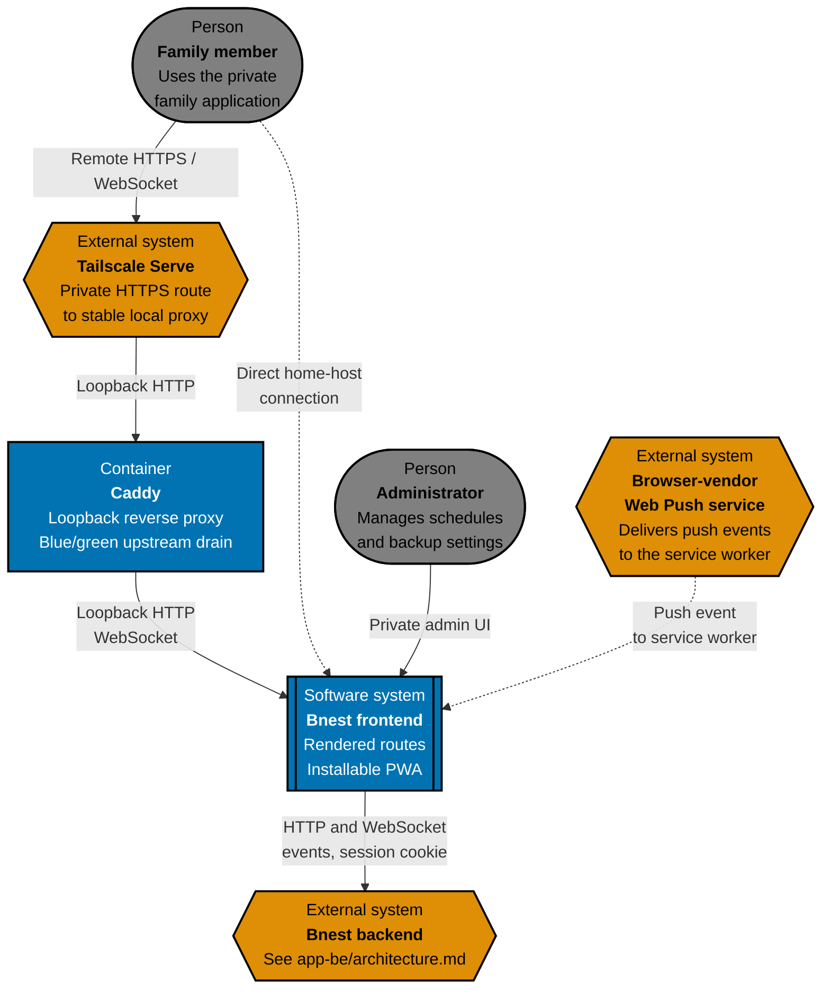
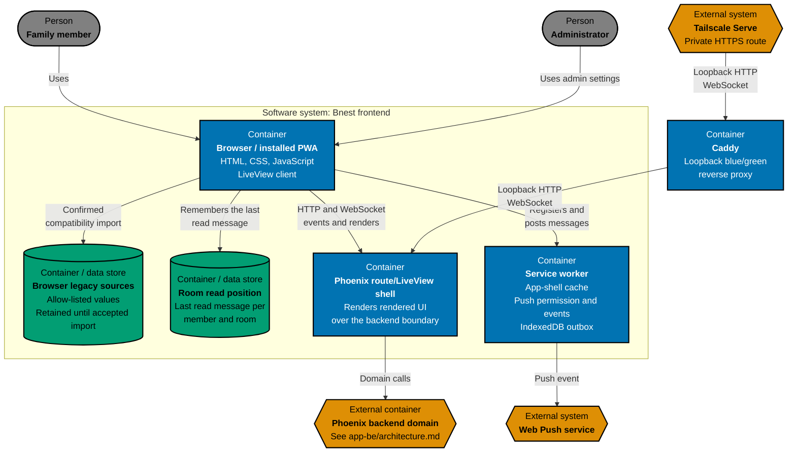

# Bnest Frontend Architecture

This is the canonical as-built C4 model for Bnest's frontend surface: routes and rendered UI, the installable PWA,
browser-owned compatibility storage, and responsive/accessible presentation. Maintain it under the repository
[architecture specification standard](../../../../repo-governance/development/architecture-specifications.md). The
backend surface is documented separately at [`app-be/architecture.md`](../app-be/architecture.md); both surfaces are
delivered by the one running `bnest-app` process and are aggregated by [`specs/apps/bnest/README.md`](../README.md).

## System Context

The frontend surface is the one place family members and administrators interact with Bnest: every rendered route,
LiveView, and browser asset. It renders through the same Phoenix process that hosts [`app-be`](../app-be/architecture.md);
the split here is by observable contract, not by a second deployed system. Elixir/Phoenix LiveView was selected so
server-rendered HTML and a persistent WebSocket connection stay authoritative without a separate client-side data
store. Caddy promotes a healthy blue or green Phoenix release with a bounded WebSocket drain; compatible LiveView
clients reconnect without a manual refresh. The compatibility revision adds a family chat room route that is
GraphQL-driven rather than LiveView-driven (see [Component View](#component-view)), and a service-worker push
subscription that, once granted, receives notifications directly from the browser vendor's Web Push service —
a delivery path that never crosses Tailscale Serve or Caddy. Both are implemented and tested behind the
`BNEST_FAMILY_CHAT_ENABLED` flag, which still defaults to off in this revision.

## Container View

The route/LiveView shell runs inside the same Phoenix OTP application as the backend domain; it is drawn as its own
container here because it is this surface's canonical observable boundary, not because it is a separately deployed
process. Phoenix binds to blue/green loopback endpoints; Caddy owns the stable loopback route and Tailscale Serve
forwards only to Caddy. The service worker (`service-worker.js` and `assets/js/family_chat/*`) is a distinct
browser-owned container: it keeps the offline app-shell cache, holds the bounded per-room IndexedDB send outbox with
backoff/seven-day-expiry, and owns the push-permission prompt and incoming `push` event handling, independent of
whether the family chat route is currently open. The room read position is a separate, page-owned browser data
store (Web Storage, one entry per member and room) holding only the id of the newest message that member has
reached the bottom of; the room reads it when it opens to decide where to place the visitor, and no server record
mirrors it.

## Component View

```mermaid
flowchart TB
    accTitle: Component View
    accDescr: Flowchart with 16 nodes and 25 connections. Nodes: External container Browser / installed PWA, External container Service worker, External data store Allow-listed browser sources, External container Phoenix backend domain, Component Chat LiveView BnestAppWeb.ChatLive, Component Chat Markdown renderer BnestAppWeb.ChatMarkdown, Component Shared message body BnestAppWeb.ChatComponents, Component Chat image route BnestAppWeb.ChatImageController, Component Sifat Allah LiveView BnestAppWeb.SifatAllahLive, Component Home/auth routes Login, setup, redirects, Component Admin settings UI Storage, schedules, Component Browser import UI data-migration route, Component Family chat route FamilyChatController, not a LiveView, Component Family chat message body message_body.js and message_content_stops.js, Component Diagram renderer assets/js/diagrams, Component Diagram engine lazy bundle in a hidden same-origin frame. Connections: Component Chat LiveView BnestAppWeb.ChatLive to External container Phoenix backend domain (Chat/learning events), Component Chat LiveView BnestAppWeb.ChatLive to Component Shared message body BnestAppWeb.ChatComponents (Renders replies as Markdown), Component Shared message body BnestAppWeb.ChatComponents to Component Chat Markdown renderer BnestAppWeb.ChatMarkdown (Markdown to safe HTML), External container Phoenix backend domain to Component Shared message body BnestAppWeb.ChatComponents (bodyHtml field), Component Chat LiveView BnestAppWeb.ChatLive to Component Diagram renderer assets/js/diagrams (ChatDiagrams hook), External container Browser / installed PWA to Component Family chat message body message_body.js and message_content_stops.js (bodyHtml over GraphQL), Component Family chat message body message_body.js and message_content_stops.js to Component Diagram renderer assets/js/diagrams (Server HTML with diagram markers), Component Diagram renderer assets/js/diagrams to Component Diagram engine lazy bundle in a hidden same-origin frame (Loads on first draw), Component Chat image route BnestAppWeb.ChatImageController to External container Phoenix backend domain (Repository image lookup), External container Browser / installed PWA to Component Chat image route BnestAppWeb.ChatImageController (Image requests GET /chat/images/*), Component Sifat Allah LiveView BnestAppWeb.SifatAllahLive to External container Phoenix backend domain (Chat/learning events), Component Home/auth routes Login, setup, redirects to External container Phoenix backend domain (Auth events), Component Admin settings UI Storage, schedules to External container Phoenix backend domain (Admin events), Component Browser import UI data-migration route to External container Phoenix backend domain (Confirmed source values), Component Family chat route FamilyChatController, not a LiveView to External container Phoenix backend domain (Renders shell, then browser owns it), External container Browser / installed PWA to Component Chat LiveView BnestAppWeb.ChatLive (Chat events and renders), External container Browser / installed PWA to Component Sifat Allah LiveView BnestAppWeb.SifatAllahLive (Learning events renders), External container Browser / installed PWA to Component Home/auth routes Login, setup, redirects (Protected events), External container Browser / installed PWA to Component Admin settings UI Storage, schedules (Admin-only events), External container Browser / installed PWA to Component Browser import UI data-migration route (Confirmed source values), External container Browser / installed PWA to External data store Allow-listed browser sources (Web Storage API until accepted import), and 4 more.
    browser(["External container<br/><b>Browser / installed PWA</b>"])
    worker(["External container<br/><b>Service worker</b>"])
    legacy[("External data store<br/><b>Allow-listed browser sources</b>")]
    backend{{"External container<br/><b>Phoenix backend domain</b>"}}

    subgraph routes["Container: Phoenix<br/>route/LiveView shell"]
        direction LR
        chat_live["Component<br/><b>Chat LiveView</b><br/>BnestAppWeb.ChatLive"]
        sifat_live["Component<br/><b>Sifat Allah LiveView</b><br/>BnestAppWeb.SifatAllahLive"]
        home["Component<br/><b>Home/auth routes</b><br/>Login, setup, redirects"]
        admin_ui["Component<br/><b>Admin settings UI</b><br/>Storage, schedules"]
        importer["Component<br/><b>Browser import UI</b><br/>data-migration route"]
        family_chat["Component<br/><b>Family chat route</b><br/>FamilyChatController,<br/>not a LiveView"]
        chat_markdown["Component<br/><b>Chat Markdown renderer</b><br/>BnestAppWeb.ChatMarkdown"]
        chat_components["Component<br/><b>Shared message body</b><br/>BnestAppWeb.ChatComponents"]
        chat_image["Component<br/><b>Chat image route</b><br/>BnestAppWeb.ChatImageController"]

        chat_live -->|Chat/learning events| backend
        sifat_live -->|Chat/learning events| backend
        home -->|Auth events| backend
        admin_ui -->|Admin events| backend
        importer -->|Confirmed source values| backend
        family_chat -->|Renders shell,<br/>then browser owns it| backend
        chat_live -->|Renders replies<br/>as Markdown| chat_components
        chat_components -->|Markdown to<br/>safe HTML| chat_markdown
        chat_image -->|Repository image lookup| backend
    end

    subgraph assets["Container: Browser assets<br/>assets/js"]
        direction LR
        message_body["Component<br/><b>Family chat message body</b><br/>message_body.js and<br/>message_content_stops.js"]
        diagrams["Component<br/><b>Diagram renderer</b><br/>assets/js/diagrams"]
        engine["Component<br/><b>Diagram engine</b><br/>lazy bundle in a hidden<br/>same-origin frame"]

        message_body -->|Server HTML with<br/>diagram markers| diagrams
        diagrams -->|Loads on first draw| engine
    end

    backend -->|bodyHtml field| chat_components
    chat_live -->|ChatDiagrams hook| diagrams
    browser -->|bodyHtml<br/>over GraphQL| message_body

    browser -->|Chat events and renders| chat_live
    browser -->|Learning events<br/>renders| sifat_live
    browser -->|Protected events| home
    browser -->|Admin-only events| admin_ui
    browser -->|Confirmed source values| importer
    browser -->|Web Storage API<br/>until accepted import| legacy
    browser -->|Initial page load| family_chat
    browser -->|Image requests<br/>GET /chat/images/*| chat_image
    browser -->|GraphQL ops<br/>over UserSocket| backend
    browser <-->|Outbox, cache,<br/>push permission| worker
    worker -->|Displays notification| browser

    classDef external fill:#808080,stroke:#000000,color:#000000,stroke-width:2px
    classDef component fill:#0173B2,stroke:#000000,color:#FFFFFF,stroke-width:2px
    classDef data fill:#029E73,stroke:#000000,color:#000000,stroke-width:2px
    class browser,worker external
    class chat_live,sifat_live,home,admin_ui,importer,family_chat,chat_markdown,chat_components,chat_image,message_body,diagrams,engine component
    class legacy data
    class backend external
    classDef default fill:#FFFFFF,stroke:#000000,color:#000000
```

The family chat route renders only the initial page shell (room list/composer scaffold); once loaded, the browser
decides for itself where in the conversation to place the visitor — reading its own stored room read position and
paging around it — and drives every subsequent read, send, and live update over GraphQL directly against
[`app-be`](../app-be/architecture.md)'s schema and `UserSocket`, bypassing the LiveView event pattern the other
routes use. That browser-owned module set under `assets/js/family_chat/*` includes the per-message action menu, the
reply-target state the composer and outbox share, and the bounded jump that walks older pages to reach a quoted
message; the route's shell also passes the browser a reply-enabled flag, which gates the requested GraphQL fields,
the menu, and the composer strip together. The service worker is drawn as a second external container here (not a
`routes` component) because it runs independently of any open route: it can display a push notification, extend the
offline app-shell cache, or retry a queued outbox entry while no family chat tab is open.

The chat reply renderer (`BnestAppWeb.ChatMarkdown`) and the shared message body component
(`BnestAppWeb.ChatComponents`) run inside the Chat LiveView, and the image route (`BnestAppWeb.ChatImageController`) is a
plain controller in the same Phoenix process. None of them holds state. `ChatComponents.markdown_body/1` renders a
Codex reply in the LiveView, and `markdown_body_html/2` renders the same markup to a string for the `bodyHtml` field of
the [`app-be`](../app-be/architecture.md) GraphQL schema, so both chat rooms share one renderer and one piece of markup.
The renderer turns each message into sanitized HTML, and the image route serves only repository raster files to a
signed-in visitor, answering every refusal with the same empty `404`. The rules for all of them are under
[Architectural Constraints](#architectural-constraints).

Two browser-owned parts sit beside the server renderer. In Family Chat, `assets/js/family_chat/message_body.js` is the
only place that inserts server HTML into the page, and `message_content_stops.js` sets which parts of a message a
keyboard reader can reach. The diagram renderer (`assets/js/diagrams/`) is part of the main bundle and serves both
rooms: in the Chat LiveView through the `ChatDiagrams` hook, and in Family Chat through an observer on the history. It
finds the server's diagram markers and draws them lazily. The Mermaid engine is a second, lazy bundle that the page
loads only when a diagram is first drawn. It runs in a hidden same-origin frame and hands the page an SVG string,
which the page shows only as an image.

The Admin settings UI component includes the Schedules page's integrity label, drawn inside it rather than as a
component of its own. On the connected mount, and again after every successful schedule or backup-folder save, the
LiveView starts one check that runs off the render path: it asks the backend for the ledger's verified runs and reconciles
them against the configured backup folder inside a task the check owns, and a ceiling (five seconds by default) cancels
that task and turns the label into its could-not-be-checked state, so the page and both forms never wait on it. The first,
disconnected render shows the checking state and reads neither the ledger nor the folder. The label prints the structured
result through the one wording function the backend serves to its log, telemetry and Mix task, so the page formats no
word or date of its own.

## Architectural Constraints

- Chat runners default to read-only, retain approval policy `never` and disabled network and web search, and accept
  only server-derived `read-only` or `workspace-write`. Only an account containing `admin` without `children` can
  explicitly enable writes; any `children` role wins, parent-only accounts remain read-only, and reconnect or clear
  resets read-only.
- The chat runner forwards only assistant message text, public reasoning summaries, and generic activity status with
  stable item IDs; raw private reasoning and tool input remain outside the transcript. Assistant text is stored as the
  model's Markdown source and is rendered only by the server-side renderer named below. Chat retains these progress
  entries beside the final assistant answer across reconnects.
- Every chat turn carries the developer instruction in `priv/codex/chat_instructions.mjs`, passed as
  `new Codex({ config: { developer_instructions } })`, so each `codex exec` process, including one that resumes a
  thread, receives it. The text is constant: no visitor value is interpolated. It asks for GitHub-flavored Markdown
  without raw HTML; for images as repository-relative paths to raster files or `https` addresses (an SVG at an `https`
  address is allowed but discouraged, and `data:` SVG, `http` addresses and absolute paths are not allowed); and for
  `mermaid` fences within the diagram limits. A contract test proves the installed CLI delivers it verbatim.
- Assistant replies and Family Chat messages render as sanitized GitHub-flavored Markdown on the server through
  `BnestAppWeb.ChatMarkdown` (MDEx), called by `BnestAppWeb.ChatComponents`. Raw HTML is escaped and shown as text.
  Link and image destinations pass a scheme gate and a sanitizer allowlist, links use only the `http`, `https` and
  `mailto` schemes, and they open in a new tab with `rel="noopener noreferrer nofollow"`. A reply that fails to parse
  or runs past its time budget shows as escaped text. Visitor messages in the Codex chat stay plain escaped text.
- A code fence tagged `mermaid` in a reply or message is marked for drawing only when the message is complete, the fence
  names an allowed diagram type, it is within the source size (6,000 bytes), line (200) and per-message (4) caps, and
  its source has no `%%{` directive, no `@{` shape data, and none of the whole words `click`, `call`, `callback`, `link`, `links` or `href`.
  The server marks it as `<pre data-bnest-diagram="mermaid">`. Any other `mermaid` fence stays an ordinary code block
  with a note that says why, and a streaming reply keeps every fence as a code block. The caps are
  `BnestAppWeb.ChatMarkdown.diagram_limits/0`.
- The browser draws only marked fences, with Mermaid 12.3.0, which is pinned and bundled (a second esbuild profile,
  `bnest_app_diagrams`; no CDN; `elkjs` is replaced by a stub). The page loads the engine lazily from the address in
  the `bnest-diagram-engine` meta tag, and only when a diagram first needs drawing. Mermaid runs with
  `securityLevel: strict` in a hidden same-origin `srcdoc` iframe, whose own Content-Security-Policy refuses every request except its script, styles and data pictures. Its SVG passes a shape guard and is then shown only
  as ``. The browser caps are 60 edges per diagram, 30 drawn diagrams per page, an
  8,000 ms render timeout (a render Mermaid never settles is cut off at it, and two such renders stop new ones), a 20,000 ms limit for the first engine start, and 300,000 SVG characters. A diagram is drawn
  only when it is within 300 px of the viewport, and never while its reply is still streaming. When a diagram cannot be
  drawn, the page shows its source and a note. The drawn picture keeps a readable minimum width and scrolls
  horizontally inside its own box, never the page.
- An image is classified by `ChatMarkdown.classify_image/1`, and the first matching rule wins. A repository-relative
  path to a `png`, `jpg`, `jpeg`, `gif` or `webp` file that is not hidden, does not sit under a runtime-data or
  dependency directory and is not reached through a symbolic link loads from `GET /chat/images/*path`. That route
  serves it to any signed-in visitor with a content type sniffed from the file's bytes, `nosniff`, and a `sandbox`
  content security policy; every refusal is the same empty `404`. An `https` address of at most 2,048 characters with no
  user info becomes an inline `` (lazy, `no-referrer`, async decoding). An `http` address is never loaded and
  shows as a link with the text "alt (image not shown)". A `data:image/png`, `jpeg`, `gif` or `webp` base64 address is
  shown inline when its payload is at most 32,768 characters (about 4,000 in Family Chat, because of its message
  limit), is valid base64, and its signature matches the type. Everything else, including SVG as `data:`, shows as the
  text "[image not shown: alt]". An inline `https` image makes the viewer's own browser contact a third-party host;
  this is accepted in ADR 003.
- Committed transcript, learning progress, and theme are never authoritative in browser storage; they are rendered
  from the backend's SQLite records after accepted import.
- Browser keys are immutable compatibility sources until envelope, normalization, and normal read-back pass; only
  the accepted key is then cleared from the browser.
- A logged-out request to `/` redirects to `/login`, so protected home actions never render without a session.
  One-time `/setup` creates every initial account and permanently closes; `/login` then protects family data. There
  is no public registration or password-recovery flow.
- The root layout links a standalone PWA manifest and Beaver Nest icon sizes for Android, desktop Chromium browsers,
  and Apple home-screen use. The service worker keeps a cached application shell as an offline fallback while
  preferring the live app whenever the home host is reachable, and never caches authenticated data.
- Every Bnest interface uses the Nest workshop visual language defined by the `--bnest-*` tokens in
  [`assets/css/chat_shared.css`](../../../../apps/bnest-app/assets/css/chat_shared.css), which `app.css` imports along
  with `diagrams.css`; reuse those tokens rather than adding page-local colors, fonts, corner treatments, or shadows.
  `chat_shared.css` also holds the shared `.markdown-body` rules of both chat rooms, `diagrams.css` holds the
  `.bnest-diagram*` rules, and `app.css` keeps each room's own bubble layout.
- Current chat continuity combines durable server records with LiveView form auto-recovery: a compatible transport
  reconnect restores the same route, completed or in-progress conversation, and unsent composer draft without
  calling `page.reload()`.
- Family chat never caches authenticated room or message content in the service worker; only the static app shell is
  cached offline. A dropped GraphQL subscription reconnects with capped backoff, catches up through
  `family_chat_messages`, and survives a Caddy blue/green promotion the same way LiveView clients do.
  Session/authentication expiry pauses the connection instead of retrying against an unauthenticated socket, and a
  logout in one tab never affects another tab's independent session.
- A reply's quote is always derived from the referenced message at read time and is never cached in the browser or
  the service worker. It is part of the message payload the room already fetches, not a second thing to store, so
  the no-authenticated-caching rule above applies to it unchanged.
- Family chat's message history exposes one tab group (ADR 003, Decision 6): a roving `tabindex` keeps one message
  focusable at a time, and the arrow keys move between messages and move that stop with them. The stop message is
  followed in the tab order by its reachable content: its body links, its quote card and its "Diagram source"
  summary always, and a table, code block or diagram picture only while it overflows (named "Table, scrollable" or
  "Code, scrollable"). The content of every other message is out of the tab order, so Tab enters and leaves the
  history once regardless of how many messages are loaded. Arrow, Home, End, Enter and Space act only when the message
  element itself has focus; **Escape** on its content returns focus to the message; Tab and Shift+Tab are never
  intercepted. A member's own send moves the stop to the new row. On the own bubble the focus ring uses
  `--bnest-sun-light`. The Codex chat keeps the normal tab order.
- A Family Chat message body is the `bodyHtml` GraphQL field, which the server renders on every resolution. The browser
  never caches it or stores it in IndexedDB, and `message_body.js` inserts it only through an inert `<template>` after a
  shape check, falling back to the text of the message.
- The IndexedDB send outbox is bounded per room and expires unsent entries after seven days, resuming delivery on
  reconnect/online transitions; Web Push permission is requested only from an explicit user gesture, never on page
  load, and the browser can revoke it at any time without breaking the room.
- Family chat's message list keeps a scroll anchor on new arrivals and announces new messages through a live region,
  and its layout, like every Bnest surface, is responsive and accessible at the viewports this repository tests.
- A family chat room opens at the reading position that member's device last reached, never at the oldest loaded
  message: it loads the messages committed after that position, one bounded page of earlier context above them, and
  marks the boundary between the two. A member with nothing unread, or no stored position, opens at the newest
  message instead. The stored position is browser-local convenience state, never authoritative and never synced
  between devices; losing it degrades only to opening at the newest message.
- The composer keeps keyboard focus across a send, so a member can keep typing without reopening the on-screen
  keyboard; `Enter` sends and `Shift`+`Enter` continues the same message.
- Sending brings the sender to their own message. A member writing from an older reading position is returned to the
  end of the loaded window, where their message appears; the new-messages indicator stays up only while the window
  still stops short of the newest committed message.
- The message history, not the document, is the room's scrolling region at every tested viewport. Every position the
  room chooses — the resumed reading position, the newest message, following a live arrival — is expressed as a
  scroll offset inside that one container, so a layout that let the page scroll instead would silently disable all
  of them.
- The Codex chat header keeps the repository access state outside its scrolling row, so on a phone the state, and for an
  administrator the write toggle, stays on screen. The other header controls scroll sideways behind an edge fade. The
  message box is capped at the smaller of 12 rem and 22 percent of the window, and the conversation is the region that
  scrolls. Family Chat's composer uses the same share of a short window (ADR 004, Decision 8).
- The Schedules page integrity label is read-only and stores nothing: it writes no file, table, flat file or cache, adds
  no route and no authorization path (the existing admin-only guard runs before the check starts), and shows no
  filesystem path, digest, destination identifier or run ID. It never delays the page, announces the change from
  checking to a result politely without moving focus, conveys every state by words and a marker as well as colour, and
  wraps its problem lines at every supported width without horizontal scrolling.

## Behaviour Traceability

Executable frontend behaviour is specified in [`behaviours/`](behaviours/). `bnest-app`'s unit and local-only
integration adapters, aggregated with [`app-be`](../app-be/architecture.md)'s root, must implement that exact
recursive corpus; `bnest-app-fe-e2e` implements this root's E2E adapter alone.

The Schedules page integrity label is specified by the backup-integrity scenarios of
[`scheduled_backups.feature`](behaviours/scheduled_backups.feature): the all-present, missing-or-changed,
could-not-be-checked and nothing-to-check states, the check after a save, the read-only, path-free and time-boxed
properties, the non-administrator denial, and the width and keyboard scenarios. The scenarios that need a forced
failure, a controlled store that outlasts the ceiling, or a server-side process observation carry `@e2e-exempt` with their
integration alternative; the rest, including the empty-ledger and never-writes scenarios, run in the browser at every
supported viewport.
